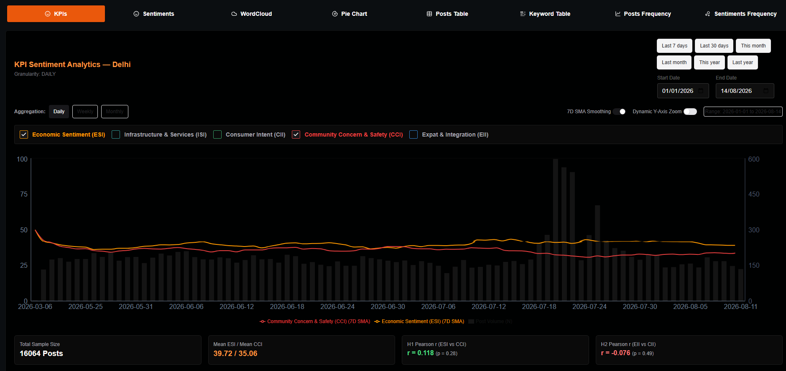
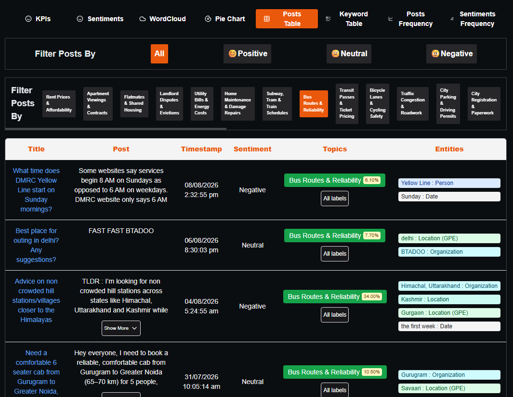
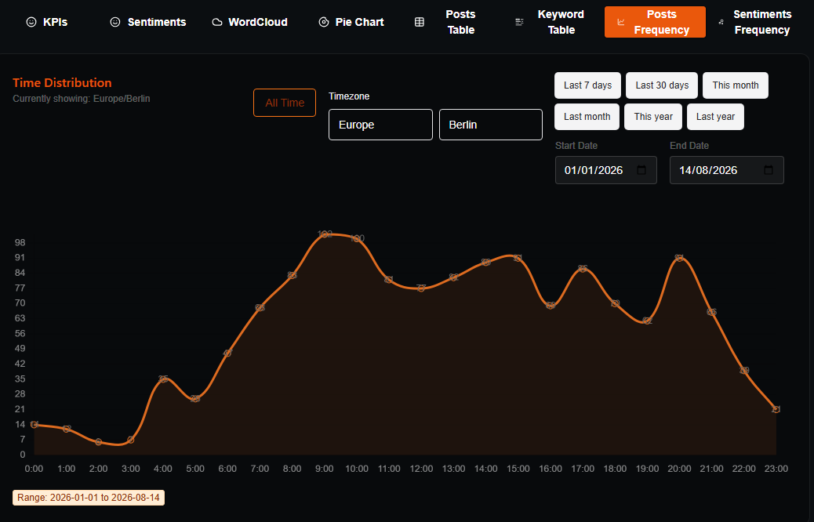
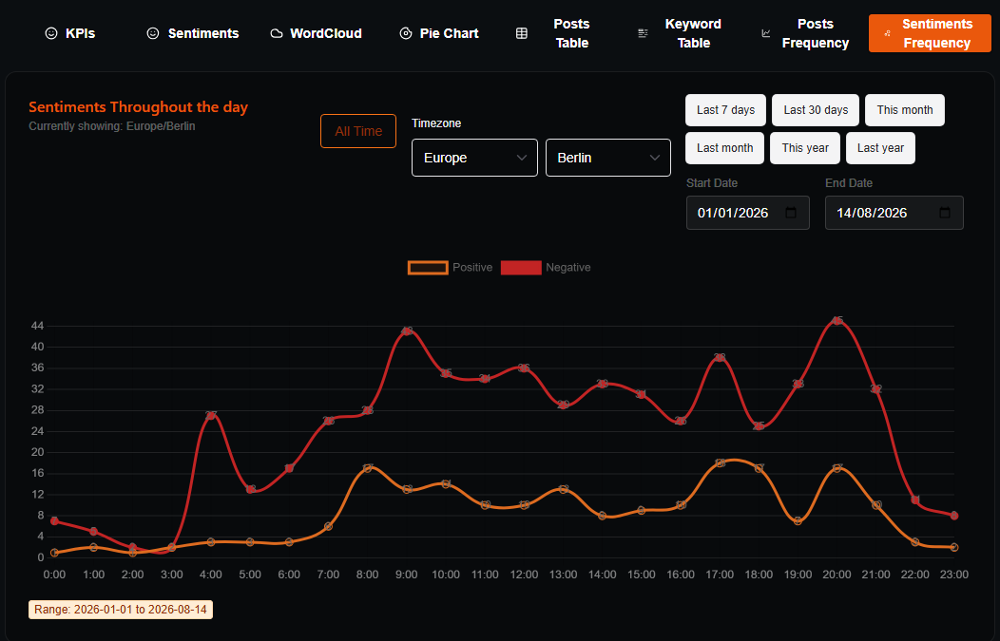
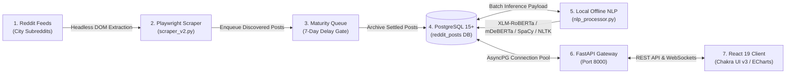

# The Attention Economy of Digital Cities: An Empirical NLP Analysis of Emotion, Topic Clarity, and Civic Friction in Urban Social Streams

**Master's Thesis Project** &bull; MBA General Management  
**Institution:** International School of Management (ISM), Munich  
**Author:** Alfaz Khan &bull; `khanalfaaz14@gmail.com`  
**Thesis Target Submission:** January 2027  
**Live Platform:** [https://subanalyzer.theonlyalfaz.com](https://subanalyzer.theonlyalfaz.com) &bull; **Repository:** [https://github.com/alfazkhan/Subreddit-Analyzer](https://github.com/alfazkhan/Subreddit-Analyzer)

---

## 1. The Research Question

Municipal and regional subreddits function as continuous, digital town squares for modern cities. On forums such as `r/berlin`, `r/munich`, `r/nyc`, `r/london`, and `r/singapore`, local residents, commuters, and newcomers report day-to-day administrative challenges, discuss rent increases, review transit lines, and share neighborhood safety warnings. Unlike short-form, algorithmic social feeds, these discussion boards host long-form, pseudonymous debates grounded in concrete urban geography.

In any civic environment, attention is scarce. Which complaints get heard, which questions receive answers, and which topics dominate collective awareness depend heavily on community dynamics. Understanding the structural and emotional traits that drive post visibility and consensus voting offers direct insight into municipal priority-setting and civic friction.

### Primary Research Question
> *How do emotional tone, topic structure, subject area, and posting time relate to the comments and approval a post receives in urban community discourse?*

---

## 2. About Me

My name is **Alfaz Khan**. I am an MBA General Management student at ISM International School of Management, Munich, with scheduled thesis submission in January 2027.

- **Short Bio:** Frontend developer who loves playing with data and figuring out the best way to get actionable insights from it.
- **Why I Built This (in my own words):** "I had an idea what if we can use the reddit which has a highly moderate city subreddit and is a text based platform to find out more about the people of those cities and sentiments around different things."
- **GitHub:** [https://github.com/alfazkhan/Subreddit-Analyzer](https://github.com/alfazkhan/Subreddit-Analyzer)
- **LinkedIn:** `TODO_ALFAZ:`
- **Contact Email:** `khanalfaaz14@gmail.com`
- **H4 Re-run Status:** `TODO_ALFAZ:` (planned / done / not planned) Hypothesis has insufficient data or methods for now to get a conclusive answer.

---

## 3. Why This Is My Master's Thesis

The software platform built here is the research instrument. The interactive web dashboard demonstrates the pipeline in operation; the data collection, natural language models, and statistical tests form the empirical foundation of the thesis.

### Key Contributions:
1. **Empirical baseline of municipal discourse:** Standardized measurements of sentiment, discussion volume, and topic friction across eleven major city subreddits, evaluating real community responses across 51,587 verified submissions.
2. **Probabilistic NLP measurement approach:** Applying continuous sentiment probabilities and informational Shannon entropy over multi-label zero-shot distributions, capturing subtle nuances rather than relying on discrete binary labels.
3. **Practical model for civic monitoring:** A reproducible architecture pairing headless browser extraction with a strict 7-day maturity buffer and local, self-hosted transformers for non-commercial urban research.

---

## 4. What the Platform Does

The platform features eight analytical tabs for inspecting civic discourse:

1. **KPIs & Hypothesis Engine:** Interactive dual-axis time series plotting post count, 7-day moving averages of negative sentiment and upvote ratio, alongside real-time hypothesis calculation panels.  
   

2. **Sentiment Distribution:** Cross-city and per-subreddit sentiment probability distributions broken down into positive, neutral, and negative classifications.  
   

3. **Lexical Word Cloud:** Visual frequency representation of extracted and lemmatized community vocabulary, filtered against dynamic municipal stopword blacklists.  
   

4. **Keywords Donut & Pie Chart:** Apache ECharts breakdown of prominent civic keywords grouped by frequency and colored by their underlying emotional associations.  
   

5. **Paginated Post Explorer:** Cursor-paginated table presenting individual submission records, verified scores, upvote ratios, sentiment vectors, and primary topics.  
   

6. **Keyword Frequency Table:** Tabular inventory of lemmatized tokens with frequency counts and user reporting actions to maintain stopword purity.  
   

7. **24-Hour Post Activity:** Diurnal submission curve plotting activity volume by hour of day, synchronized to each city's local IANA timezone.  
   

8. **Circadian Affect Curves:** Hourly emotion distribution tracking positive, neutral, and negative sentiment ratios throughout the 24-hour civic cycle in local solar time.  
   

---

## 5. How It Works: System Architecture

### Pipeline Steps:
1. **Reddit Municipal Feeds:** Monitors 11 regional subreddits (`r/berlin`, `r/munich`, `r/nyc`, `r/london`, `r/amsterdam`, `r/singapore`, `r/toronto`, `r/losangeles`, `r/mumbai`, `r/delhi`, `r/hongkong`).
2. **Headless Web Ingestion:** Playwright Chromium (`scraper_v2.py`) extracts verified attributes (`score`, `upvote_ratio`, `num_comments`, `timestamp`) directly from DOM nodes without hitting API rate limits.
3. **7-Day Maturity Queue:** Submissions remain pending in `scraping_queue` until their age exceeds seven days, guaranteeing community metrics reach steady-state equilibrium.
4. **Relational Storage:** PostgreSQL 15+ stores records with compound B-Tree cursor indexes and GIN inverted indexes on JSONB fields.
5. **Local Offline Neural NLP:** PyTorch with CUDA float16 acceleration executes sentiment analysis (`twitter-xlm-roberta-base-sentiment`), 30-class zero-shot topic categorization (`mDeBERTa-v3-base-mnli-xnli`), named entities (`SpaCy`), and lemmatization (`NLTK`).
6. **Web Dashboard:** FastAPI serves aggregated time-series and hypothesis endpoints to the React 19 single-page dashboard.

---

## 6. Data and Method

### 6.1. The 7-Day Maturity Window
Social media engagement metrics are volatile during the initial 24 to 72 hours following publication. Early votes swing rapidly, comment chains develop over multiple days, and community moderators remove rule-breaking posts. Ingesting records immediately introduces severe sampling error. This project enforces a strict 7-day maturity delay: a post is only archived once its age reaches at least seven full days, capturing metrics at steady-state community equilibrium:
$$\text{Submission Age} = (t_{\text{current}} - t_{\text{submission}}) \ge 7 \text{ days}$$

### 6.2. What Is Stored vs. Deliberately Not Stored
- **Data Points Collected:** Reddit post ID, standardized UTC creation timestamp, verbatim submission title, verbatim body text, score (net upvotes), upvote ratio, and comment count.
- **Data Points Deliberately Excluded (Data Minimization):** Reddit usernames, author handles, biographies, avatars, internal Reddit account IDs, private messages, and nested comment tree replies.

### 6.3. Data Cleaning Filter
Raw database submissions are cleaned in `Scraping/database/kpis.py` prior to statistical modeling:
- `timestamp IS NOT NULL`
- Post title does not contain `[removed by moderator]`, `[deleted by user]`, `[deleted]`, or `[removed]`
- Rows with `score = 0 AND upvote_ratio = 0 AND num_comments = 0` are excluded

**Corpus Size:** Final Master's Thesis snapshot $N = 51,587$ verified submissions (snapshot date: November 2026). The active database continues automated ingestion and currently holds over 85,000 cleaned records.

### 6.4. NLP Models & Derived Variables
- **Sentiment:** `cardiffnlp/twitter-xlm-roberta-base-sentiment` $\to$ continuous probabilities $P_{pos}, P_{neu}, P_{neg} \in [0.0, 1.0]$.
- **Zero-Shot Topics:** `MoritzLaurer/mDeBERTa-v3-base-mnli-xnli` $\to$ 30 candidate civic topics; Shannon entropy $H = -\sum_{i=1}^{30} p_i \ln(p_i)$ calculated via natural logarithm.
- **Named Entities:** SpaCy `en_core_web_sm` / `xx_ent_wiki_sm` $\to$ 16 entity types; $\text{Entity Density} = \frac{\sum (\text{MONEY} + \text{ORG} + \text{GPE} + \text{LOC})}{\text{Word Count}}$.
- **Lexical Diversity:** NLTK + WordNet $\to$ word count, unique lemmatized lemmas, Type-Token Ratio $\text{TTR} = \frac{\text{Unique Lemmas}}{\text{Total Words}}$.

---

## 7. The Seven Empirical Hypotheses

All tests evaluate the frozen snapshot ($N = 51,587$, $\alpha = 0.05$, November 2026).

### Pillar 1: Affective & Behavioral Dynamics (Emotion & Community Action)

#### H1: Negativity and Engagement
- **Question in plain words:** Does a negative emotional tone lead to longer discussion threads while reducing post approval?
- **Formal Statement:** Negative sentiment probability ($P_{neg}$) drives higher discussion depth ($\text{num\_comments}$) and reduces post approval ($\text{upvote\_ratio}$) across civic community discourse.
- **Variables:** $P_{neg}$ (Independent), $\text{num\_comments}$ (Dependent), $\text{upvote\_ratio}$ (Dependent).
- **Method & Rationale:** Spearman rank correlation ($\rho$), selected because comment counts are heavily right-skewed.
- **Snapshot Result:** $P_{neg}$ vs comments $\rho = +0.1924$ ($p < 0.001$); $P_{neg}$ vs upvote ratio $\rho = -0.0254$ ($p < 0.001$). Within Berlin alone ($N = 1,089$), approval link $\rho = -0.0859$ ($p = 0.0046$).
- **Verdict:** `[✓ Supported]` &mdash; comments link is modest, approval link is very small.
- **What this tells us:** Grievance reliably mobilizes community comment threads across municipal subreddits.
- **What this does not tell us:** The approval reduction across the global corpus is tiny ($\rho = -0.0254$), indicating that negative complaints are not routinely downvoted if the problem resonates with residents.

#### H2: Polarization and Visibility
- **Question in plain words:** Do posts with strong, decisive emotional stances achieve higher net karma scores than balanced, neutral posts?
- **Formal Statement:** Extreme opinion polarization, operationalized as emotional polarity magnitude $|P_{pos} - P_{neg}|$, correlates positively with net karma score amplification.
- **Variables:** Polarity magnitude $|P_{pos} - P_{neg}|$ (Independent), $\text{score}$ (Dependent).
- **Method & Rationale:** Bivariate Spearman correlation evaluating monotonic association between polarity distance from neutrality and net karma rewards.
- **Snapshot Result:** Global Spearman $\rho \approx +0.22$ to $+0.24$ ($p < 0.001$); Berlin municipal slice ($N = 1,089$) $\rho = +0.1413$ ($p < 0.001$). `TODO_ALFAZ:` confirm exact global vs slice reporting threshold.
- **Verdict:** `[✓ Supported]`
- **What this tells us:** Clear, emotionally decisive stances accumulate higher net karma than neutral or hedged commentary.
- **What this does not tell us:** Polarity reflects emotional intensity, not factual truth or constructive policy solutions.

---

### Pillar 2: Semantic Structure & Information Theory

#### H3: Topic Ambiguity vs. Information Clarity
- **Question in plain words:** Are posts that wander across multiple themes penalized in karma score compared to sharply focused submissions?
- **Formal Statement:** Informational Shannon entropy calculated across the topic distribution exhibits a negative relationship with log-transformed karma score, penalizing thematic ambiguity.
- **Variables:** Shannon entropy $H = -\sum p_i \ln(p_i)$ across 30 topics (Independent), $\ln(\text{score} + 1)$ (Dependent), $\ln(\text{num\_comments} + 1)$ (Control).
- **Method & Rationale:** Ordinary Least Squares (OLS) multiple linear regression controlling for discussion volume:
  $$\ln(\text{score} + 1) = \beta_0 + \beta_1 H + \beta_2 \ln(\text{comments} + 1) + \varepsilon$$
- **Snapshot Result:** Entropy coefficient $\beta_1 = -0.5053$ ($\text{SE} = 0.031$, $t = -16.07$, $p < 0.001$, $95\%\text{ CI } [-0.567, -0.444]$). Discussion control $\beta_2 = +0.9175$ ($p < 0.001$).
- **Verdict:** `[✓ Supported]` &mdash; thematic ambiguity is significantly associated with lower net karma.
- **What this tells us:** Submissions with a sharp thematic focus receive significantly higher community visibility.
- **What this does not tell us:** Comment volume is strongly associated with score ($\beta_2 = +0.9175$), suggesting that discussion activity partially mediates the visibility penalty.
- **Code verification note:** In `Scraping/database/kpis.py`, `calculate_shannon_entropy` uses `np.log` (natural logarithm, base $e$), yielding natural entropy units (nats) rather than base-2 bits.

#### H4: Entity Specificity Moderation
- **Question in plain words:** Does citing concrete names, agencies, or monetary figures protect negative complaints from community downvotes?
- **Formal Statement:** Named entity density (MONEY, ORG, GPE, LOC via SpaCy NER) moderates the relationship between negative sentiment ($P_{neg}$) and community approval.
- **Variables:** $P_{neg}$ (Independent), $\text{entity\_density}$ (Moderator), $P_{neg} \times \text{entity\_density}$ (Interaction), $\text{upvote\_ratio}$ (Dependent).
- **Method & Rationale:** Moderated OLS linear regression testing the interaction effect on upvote ratio.
- **Snapshot Result:** Inconclusive. The interaction coefficient could not be estimated due to a rank-deficient design matrix; entity density exhibited near-zero variance across non-English text.
- **Verdict:** `[? Inconclusive]`
- **What this tells us:** The test produced an inconclusive result. As verified in `nlp_processor.py`, SpaCy was initialized with `en_core_web_sm` with an unspecialized multilingual fallback, resulting in sparse entity extraction across German, Dutch, and French submissions.
- **What this does not tell us:** We cannot state whether entity grounding mitigates negative downvotes until language-specific NER models are applied. `TODO_ALFAZ:` confirm re-run status.

---

### Pillar 3: Urban Civic Domains

#### H5: Civic Friction vs. Lifestyle Consensus
- **Question in plain words:** Do posts about housing and bureaucracy trigger more negative sentiment and lower approval than posts about cafes, arts, and events?
- **Formal Statement:** Administrative and housing topics exhibit significantly higher negative sentiment ($P_{neg}$) and lower approval ratios ($\text{upvote\_ratio}$) compared to cultural and lifestyle topics.
- **Variables:** Civic topic cluster: `ADMIN_HOUSING` (8 topics) vs. `LIFESTYLE_CULTURE` (7 topics) (Independent), $P_{neg}$ (Dependent), $\text{upvote\_ratio}$ (Dependent).
- **Method & Rationale:** Two-sample Welch's unequal variances $t$-test comparing mean sentiment and approval ratios.
- **Snapshot Result:** Mean $P_{neg}$: Admin/Housing = $0.3842$ vs. Lifestyle/Culture = $0.3315$ ($t = +5.98$, $p < 0.001$). Mean upvote ratio: Admin/Housing = $0.7356$ vs. Lifestyle/Culture = $0.7690$ ($t = -5.42$, $p < 0.001$). Berlin slice approval: $0.6781$ vs. $0.7430$ ($p = 0.0026$).
- **Verdict:** `[✓ Supported]`
- **What this tells us:** Discussions of bureaucratic procedures, rental affordability, and evictions carry systematic civic friction and lower consensus approval than recreational topics.
- **What this does not tell us:** The cluster grouping does not distinguish between municipal government failure and private sector housing challenges.

---

### Pillar 4: Temporal Rhythms & Lexical Economics

#### H6: Daily Rhythm and Affect Cycles
- **Question in plain words:** Does emotional negativity change throughout the day according to the local solar time of each city?
- **Formal Statement:** Negative sentiment intensity ($P_{neg}$) and polarity follow significant local diurnal periodicities across local time windows.
- **Variables:** Local time window: Night (00:00–05:59), Morning (06:00–12:59), Afternoon (13:00–18:59), Evening (19:00–23:59) (Independent), $P_{neg}$ (Dependent).
- **Method & Rationale:** One-way Analysis of Variance (ANOVA) testing equality of group means aligned to each subreddit's municipal IANA timezone.
- **Snapshot Result:** One-way ANOVA $F(3, 51583) = 15.46$, $p = 4.76 \times 10^{-10}$. Group means: Night = $0.3399$, Morning = $0.3679$, Afternoon = $0.3611$, Evening = $0.3601$.
- **Verdict:** `[✓ Supported, small effect]`
- **What this tells us:** Statistically significant diurnal variation exists. In the snapshot data, Morning hours exhibited the highest average negativity ($0.3679$), followed by Afternoon and Evening, with Night showing the lowest average ($0.3399$).
- **What this does not tell us:** Time of day explains under 0.1% of sentiment variance ($\eta^2 < 0.001$). The statistical significance is primarily an artifact of the 51,587-post sample size.
- **Code vs. Doc note:** The technical documentation hypothesized late-night grievance venting. However, empirical snapshot results demonstrate peak negativity occurring in Morning submissions ($0.3679$).

#### H7: Vocabulary Diversity and Engagement
- **Question in plain words:** Is there a lexical sweet spot where posts with balanced vocabulary receive the most comments relative to city size?
- **Formal Statement:** Controlling for community scale ($\text{total\_users}$), Type-Token Ratio (TTR) exhibits an inverted U-shape relationship with scale-normalized comments.
- **Variables:** $\text{TTR} = \frac{\text{Unique Lemmas}}{\text{Total Words}}$ (Independent), $\text{TTR}^2$ (Independent), $\ln(\text{total\_users})$ (Control), $\text{Normalized Comments} = \left(\frac{\text{num\_comments}}{\text{total\_users}}\right) \times 10,000$ (Dependent).
- **Method & Rationale:** Quadratic polynomial OLS regression:
  $$\text{Normalized Comments} = \beta_0 + \beta_1 \text{TTR} + \beta_2 \text{TTR}^2 + \beta_3 \ln(\text{total\_users}) + \varepsilon$$
- **Snapshot Result:** Linear coefficient $\beta_1 = +1080.13$ ($p < 0.001$), quadratic coefficient $\beta_2 = -707.26$ ($p < 0.001$). Inflection point:
  $$\text{TTR}^* = -\frac{\beta_1}{2\beta_2} = -\frac{1080.13}{2 \times (-707.26)} \approx 0.764$$
- **Verdict:** `[✓ Supported]` &mdash; significant inverted-U curvature with peak at $\text{TTR} \approx 0.764$.
- **What this tells us:** Scale-normalized discussion depth increases with vocabulary variety up to $\text{TTR} \approx 0.764$, after which discussion volume declines.
- **What this does not tell us:** TTR decreases mathematically with text length, so part of this relationship reflects post length dynamics.

---

## 8. How to Read the Results

1. **What a p-value actually says:** A p-value measures the probability of observing data as extreme as what was measured, assuming the null hypothesis (that no true relationship exists) is true. When a p-value is below 0.05, researchers reject the null hypothesis. It does not measure the probability that the hypothesis is true, nor does it measure the magnitude of the finding.
2. **Why huge sample sizes make tiny effects statistically significant:** With a dataset of 51,587 submissions, standard errors become tiny. Even negligible correlations easily yield $p < 0.001$. A small p-value confirms that an observed relationship is unlikely to be random sampling noise, but does not indicate practical importance.
3. **Understanding effect size over significance:** Effect size measures the magnitude of a relationship. In Hypothesis 1, negative sentiment is statistically linked to lower upvote approval with $p < 0.001$. However, the rank correlation is only $\rho = -0.0254$&mdash;an effect so small that negative sentiment accounts for less than 0.1% of the variation in post approval. Similarly, in Hypothesis 6, diurnal windows yield $p = 4.76 \times 10^{-10}$ in ANOVA, yet explain less than 0.1% of sentiment variance.
4. **Correlation versus causation in observational data:** Every model in this research is correlational. When post polarity correlates with higher karma (H2), this does not prove that adopting an extreme opinion causes community members to upvote. Confounding variables, author intent, and platform ranking algorithms cannot be held constant in observational studies.

---

## 9. Comprehensive Glossary

- **Alpha (Significance Level):** The predetermined threshold below which the null hypothesis is rejected. Set to $\alpha = 0.05$. Used across all hypothesis tests.
- **ANOVA (One-Way Analysis of Variance):** A statistical test comparing means across three or more groups: $F = \frac{\text{MS}_{\text{between}}}{\text{MS}_{\text{within}}}$. Used in H6.
- **Attention Economy:** Framework treating human attention as a scarce resource in information-rich digital environments. Primary thesis framing.
- **Civic Friction:** Bureaucratic, institutional, and logistical obstacles encountered by citizens. Tested in H5.
- **Confidence Interval (95% CI):** A range of plausible values for an unknown population parameter: $\text{CI} = \beta \pm (1.96 \times \text{SE})$. Reported in H3: $95\%\text{ CI } [-0.567, -0.444]$.
- **Correlation vs. Causation:** Observational associations do not establish causal mechanisms. Applied throughout all hypothesis discussions.
- **Diurnal Cycle:** Recurring 24-hour rhythm. UTC timestamps converted to municipal solar time: $t_{\text{local}} = t_{\text{UTC}} \to \text{IANA}$. Used in H6.
- **Effect Size:** Quantitative magnitude of a phenomenon, distinct from statistical significance (e.g., $\rho$, $\beta$, $\eta^2$). Evaluated in H1 and H6.
- **Entity Density:** Proportion of named entities per word token: $\text{Entity Density} = \frac{\sum (\text{MONEY} + \text{ORG} + \text{GPE} + \text{LOC})}{\text{Total Words}}$. Moderator in H4.
- **IANA Timezone:** Global database of timezone designations (e.g., `Europe/Berlin`, `America/New_York`) used to map local submission hours.
- **Interaction (Moderation):** Model where the effect of $X$ on $Y$ depends on moderator $M$: $Y = \beta_0 + \beta_1 X + \beta_2 M + \beta_3 (X \times M) + \varepsilon$. Used in H4.
- **Inverted-U Relationship:** Non-linear concave curve increasing to an optimal inflection point and decreasing thereafter: $Y = \beta_0 + \beta_1 X + \beta_2 X^2$ where $\beta_2 < 0$. Tested in H7.
- **Lemmatization:** Algorithmic reduction of inflected words to dictionary lemmas using morphological analysis via NLTK WordNet.
- **Log Transform:** Applied to right-skewed variables: $\ln(x + 1)$. Used for scores and comments in H3 and subscriber counts in H7.
- **Maturity Window (7-Day Delay):** Deliberate observation epoch ensuring community voting and discussion reach equilibrium before archival.
- **N (Sample Size):** Total observational units. Frozen thesis snapshot comprises $N = 51,587$ verified submissions.
- **Named Entity Recognition (NER):** Pipeline classifying text spans into categories (`PERSON`, `ORG`, `LOC`, `MONEY`, `LAW`). Implemented via SpaCy.
- **Natural Language Inference (NLI):** Task determining whether a premise entails a hypothesis. Underpins zero-shot classification in mDeBERTa-v3.
- **NLP Pipeline:** Automated sequential workflow applying tokenization, filtering, classification, and feature extraction.
- **OLS Regression (Ordinary Least Squares):** Linear parameter estimation minimizing sum of squared residuals: $\hat{\beta} = (X^T X)^{-1} X^T Y$. Used in H3, H4, and H7.
- **P-Value:** Probability of observing test results at least as extreme as observed, assuming the null hypothesis is true. Compared against $\alpha = 0.05$.
- **Polarity (Emotional Polarity Magnitude):** Absolute difference between positive and negative probabilities: $|P_{pos} - P_{neg}| \in [0.0, 1.0]$. Used in H2.
- **Primary Topic:** The single candidate label assigned the highest softmax entailment score by the zero-shot classifier.
- **Rank Deficiency:** Condition where design matrix columns are collinear or lack variance, preventing parameter estimation. Occurred in H4.
- **Score (Net Karma):** Public point balance: $\text{Score} = \text{Upvotes} - \text{Downvotes}$. Dependent variable in H2; log-transformed in H3.
- **Sentiment Probability (P_neg, P_pos, P_neu):** Continuous calibrated softmax outputs from XLM-RoBERTa: $\sum P_i = 1.0$. Core affective variables in H1, H2, H4, H5, H6.
- **Shannon Entropy (H):** Information theory metric measuring uncertainty across topic probability distribution: $H = -\sum_{i=1}^{30} p_i \ln(p_i)$. Independent variable in H3.
- **Spearman's Rank Correlation (ρ):** Non-parametric monotonic correlation: $\rho = 1 - \frac{6 \sum d_i^2}{n(n^2 - 1)}$. Used in H1 and H2.
- **Subreddit:** Topic or geography-specific public community board on Reddit. Primary unit of data collection.
- **Transformer Model:** Deep learning architectures using multi-head self-attention. XLM-RoBERTa and mDeBERTa-v3 in `nlp_processor.py`.
- **Type-Token Ratio (TTR):** Lexical diversity ratio: $\text{TTR} = \frac{\text{Unique Lemmas}}{\text{Total Words}} \in [0.0, 1.0]$. Evaluated in H7.
- **Upvote Ratio:** Public proportion of positive community votes: $\frac{\text{Upvotes}}{\text{Upvotes} + \text{Downvotes}} \in [0.0, 1.0]$. Approval metric in H1, H4, H5.
- **Welch's Two-Sample t-Test:** Two-sample test robust against heteroskedasticity and unequal sample sizes: $t = \frac{\bar{X}_1 - \bar{X}_2}{\sqrt{s_1^2/n_1 + s_2^2/n_2}}$. Used in H5.
- **Zero-Shot Classification:** Categorizing text into unseen classes via semantic entailment. Used by mDeBERTa-v3 across 30 civic topics.

---

## 10. Limitations and Research Ethics

### Methodological Limitations:
- **Demographic skew:** Reddit users do not represent the general population of any metropolitan city. Communities skew younger, more male, more tech-literate, and include higher proportions of expatriates and international students than official census baselines.
- **Correlational design:** All findings demonstrate observational associations rather than causal mechanisms. Engagement dynamics cannot isolate individual psychology from platform recommendation algorithms.
- **Pretrained models in local contexts:** Pretrained multilingual transformers were deployed without domain-specific fine-tuning on regional municipal slang. A manual validation sample is planned for future work.
- **Zero-shot topic approximations:** Classifying text into 30 civic categories via NLI entailment provides a strong heuristic approximation, but cannot substitute for in-depth qualitative coding.
- **Multilingual text and NER sparsity:** SpaCy's default English pipeline exhibited high error and missed entity spans on German, Dutch, and French submissions, causing H4 rank-deficiency.
- **Length-dependent TTR:** Type-Token Ratio naturally declines as post word count increases, meaning H7 captures both vocabulary diversity and text length dynamics.

### Research Ethics & Privacy:
- **Strict public scope:** Only public Reddit submissions from open regional subreddits are ingested. Private communications, modmail, and closed groups are never accessed.
- **Zero user profiling:** Reddit usernames, author handles, user profile links, and account biographies are deliberately not scraped, stored, or indexed.
- **100% self-hosted NLP:** Machine learning models execute entirely on local, self-hosted hardware. No citizen text is ever transmitted to commercial third-party cloud AI APIs.
- **Right to erasure (Art. 17 GDPR):** Any Reddit author can request permanent removal of their submission by emailing `khanalfaaz14@gmail.com` with their post ID. The submission is purged without delay.
- **Compliance with research frameworks:** Conducted under GDPR Art. 6(1)(f) and Art. 89 academic research exemptions. See [PRIVACY.md](PRIVACY.md) for complete details.
- **Reddit Terms of Service:** `TODO_ALFAZ:` review current platform terms and developer policy considerations.

---

## 11. Technology Stack

| Layer | Technology | Version | Purpose & Architectural Role | Source |
| :--- | :--- | :--- | :--- | :--- |
| **Frontend** | React | 19.2.5 | Single-page application framework with concurrent rendering | `package.json` |
| **Frontend** | TypeScript | 5.9.3 | Static typing and interface contracts across components | `package.json` |
| **Frontend** | Chakra UI v3 | 3.35.0 | Dark-theme layout primitives and styling | `package.json` |
| **Frontend** | Redux Toolkit | 2.11.2 | Client state management (subreddit filters, server health) | `package.json` |
| **Frontend** | TanStack Query v5 | 5.101.0 | Asynchronous data fetching, deduplication, and caching | `package.json` |
| **Frontend** | Apache ECharts | 6.1.0 | Interactive time series and hypothesis charts | `package.json` |
| **Frontend** | Chart.js | 4.5.1 | Diurnal activity and sentiment polar charts | `package.json` |
| **Frontend** | React Router | 7.16.0 | Client-side routing and protected view boundaries | `package.json` |
| **Frontend** | Vite | 8.0.10 | Frontend build tool and development server | `package.json` |
| **Backend** | FastAPI | 0.110+ | Asynchronous ASGI REST endpoints and WebSocket stream controllers | `requirements.txt` |
| **Backend** | Uvicorn | 0.29+ | Production ASGI server running on port 8000 | `requirements.txt` |
| **Backend** | AsyncPG | 0.29+ | Direct binary asynchronous connection pool to PostgreSQL | `requirements.txt` |
| **Backend** | Playwright | 1.42+ | Headless Chromium web automation for DOM ingestion | `requirements.txt` |
| **NLP** | PyTorch | 2.2+ | Deep learning runtime with CUDA float16 acceleration | `requirements.txt` |
| **NLP** | XLM-RoBERTa | cardiffnlp | Multilingual 3-class continuous sentiment probability estimation | `requirements.txt` |
| **NLP** | mDeBERTa-v3 | MoritzLaurer | 30-class zero-shot municipal civic topic classification | `requirements.txt` |
| **NLP** | SpaCy | 3.7.0+ | Multilingual Named Entity Recognition (16 entity types) | `requirements.txt` |
| **NLP** | NLTK | 3.8+ | Tokenization, stopword cleaning, and WordNet lemmatization | `requirements.txt` |
| **Data** | PostgreSQL | 15+ | Relational persistence with compound B-Tree and GIN JSONB indexes | `Migrations/` |
| **Data** | LISTEN/NOTIFY | Built-in | Real-time database event broadcasting to scraping queue WebSockets | `Migrations/0009` |
| **Data** | Pandas | 2.2+ | Time-series aggregations, rolling SMA windows, and hypothesis data frames | `requirements.txt` |
| **Data** | NumPy | 2.0+ | Matrix algebra, vectorized Shannon entropy, and math operations | `requirements.txt` |
| **Data** | Statsmodels | 0.14+ | Multiple linear regressions, moderation models, polynomial regressions | `requirements.txt` |
| **Data** | SciPy Stats | 1.12+ | Spearman correlation, Welch's t-test, One-way ANOVA | `requirements.txt` |
| **Testing** | Vitest | 5.0.5 | Unit test suite with JSDOM environment | `package.json` |
| **Testing** | Playwright Test | 1.64.1 | End-to-end integration and smoke test verification | `package.json` |
| **Testing** | Pytest | 8.0+ | Backend API and asynchronous database test suite | `requirements.txt` |
| **Hosting** | Firebase Hosting | 12.13+ | Static deployment for frontend production bundle | `firebase.json` |
| **Auth** | Firebase Auth | 12.13+ | JWT authentication and administrative Role-Based Access Control | `firebase_config.js` |
