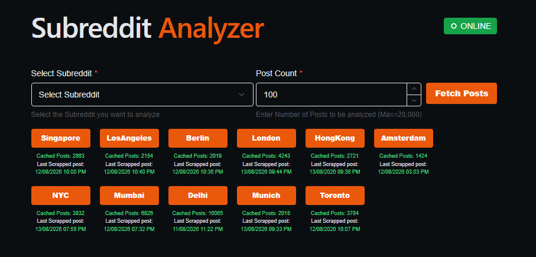
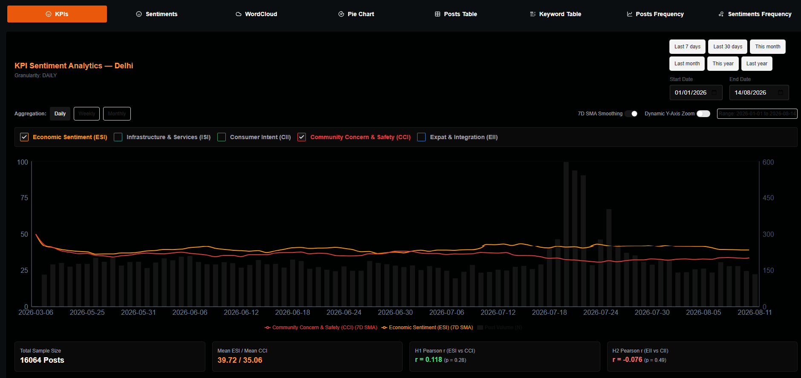
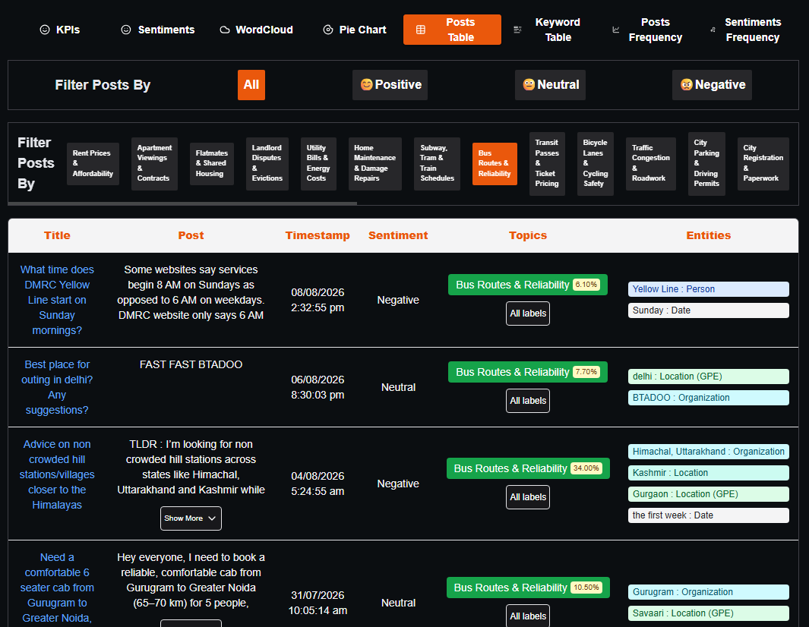
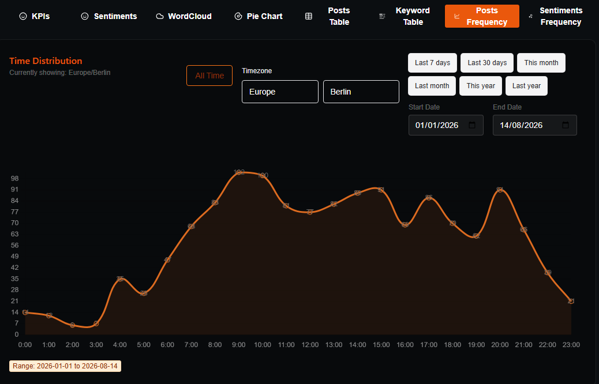
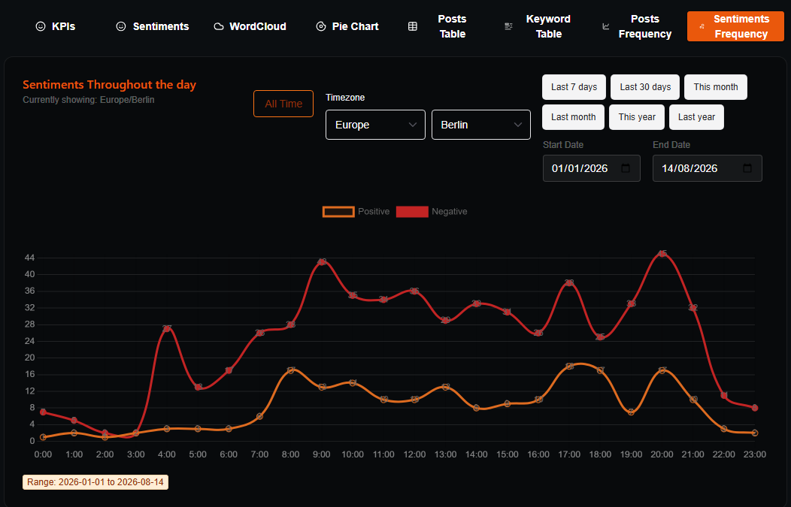

<div align="center">


# Subreddit Analyzer

A full-stack civic analytics dashboard designed to scrape, process, and visualize Reddit community data (sentiment, keywords, topics, named entities, and empirical KPIs) across municipal subreddits.

<br>

<a href="https://subanalyzer.theonlyalfaz.com" target="_blank" rel="noopener noreferrer">
  
</a>

</div>

<br>

<div align="center">

## 🛠 Technology Stack

### Frontend
<br>


### Backend
<br>


</div>

<br>

<div align="center">

## 📊 Features & Analytics

This project combines Playwright scraping, PostgreSQL persistence, transformer-based NLP, empirical hypothesis testing, and interactive dashboard visualizations built with Apache ECharts and Chart.js.

<details>
<summary><b>🖼️ View Dashboard Screenshots (Click to Expand)</b></summary>
<br>

### Subreddit Selection & Cache Summary


### KPI Analytics


### Sentiment Analysis Breakdown


### Keyword Frequency & Entity Recognition


### Cursor-Paginated Data Tables


### Diurnal Post Frequency


### Local Timezone-Synchronized Sentiment Rhythms


</details>

</div>

---

<div align="center">

## 🚀 Setup & Installation

</div>

### 1. Database Configuration
Ensure PostgreSQL is running locally or remotely and create a dedicated database for the analyzer. Configure your connection settings in `Scraping/config.py` (see below), then apply the SQL schema migrations in `Scraping/Migrations/` using `python migrate.py`.

### 2. Backend Setup
Navigate to the backend directory and set up your Python virtual environment:

```bash
cd Scraping
python -m venv .venv
```

Activate the virtual environment:

* **Windows (PowerShell):** `.venv\Scripts\Activate.ps1` (or `.venv\Scripts\activate.bat` in CMD)
* **macOS/Linux:** `source .venv/bin/activate`

#### Option A: Automated Setup
Run the provided setup script to install dependencies, download NLTK corpora and spaCy models, pre-cache Hugging Face models, and install Playwright Chromium:

* **Cross-platform:** `python setup.py`
* **macOS/Linux:** `bash setup.sh`

#### Option B: Manual Dependency Installation

```bash
pip install -r requirements.txt
python -m spacy download en_core_web_sm
python -m spacy download xx_ent_wiki_sm
python -m playwright install chromium
```

#### Configuration, Credentials & Environment Variables

The backend uses the following files inside the `Scraping/` directory (**never commit these to version control**):

1. **`config.py`**: Defines `DB_CONFIG` (asyncpg/PostgreSQL connection dict), `SCRAPE_INTERVAL`, and `MAX_CONCURRENT_TABS`.
2. **`firebase_creds.json`**: Service account private key generated from Firebase Console (*Project Settings > Service Accounts*).
3. **`auth.json` (Optional, recommended for scraping)**: Playwright browser session state JSON for authenticated Reddit scraping to reduce rate limiting.

Optional environment variables:

* `APP_ENV`: Set to `production` when deploying to production.
* `API_HOST`: Bind host for FastAPI/Uvicorn (defaults to `0.0.0.0`).
* `CORS_ALLOWED_ORIGINS`: Comma-separated list of additional allowed CORS origins (e.g., `http://192.168.1.50:5173`).
* `FORCE_CPU`: Set to `1` to force CPU inference (`run_api.py` defaults this to `1`; `nlp_processor.py` uses CUDA when available unless `FORCE_CPU=1`).
* `HF_HOME` / `HF_HUB_OFFLINE` / `TRANSFORMERS_OFFLINE`: Configure Hugging Face model cache directory and offline mode (`nlp_processor.py` defaults to offline mode using cached models).
* `NLTK_DATA`: Optional custom directory path for NLTK corpora (in addition to standard OS locations and any project-local `nltk_data/` directory).

#### Run Migrations, API Gateway, and Worker

```bash
# Apply PostgreSQL schema migrations
python migrate.py

# Terminal 1: Run the FastAPI Gateway
python run_api.py

# Terminal 2: Run the Background Scraper & NLP Worker
python run_worker.py
```

*The API will be available at `http://localhost:8000`. See [Scraping/API Documentation.md](./Scraping/API%20Documentation.md) for full endpoint details.*

### 3. Frontend Setup

Create a `.env.local` file in the repository root with your Firebase client web configuration:

```env
VITE_FIREBASE_API_KEY=...
VITE_FIREBASE_AUTH_DOMAIN=...
VITE_FIREBASE_PROJECT_ID=...
VITE_FIREBASE_STORAGE_BUCKET=...
VITE_FIREBASE_MESSAGING_SENDER_ID=...
VITE_FIREBASE_APP_ID=...
```

If pointing the frontend at a local backend instead of the production host, update `BASE_URL` and `wsUrl` in `src/util/constants.ts`. Then install dependencies and start the Vite dev server from the project root:

```bash
npm install
npm run dev
```

*The React dashboard will be available at `http://localhost:5173`.*

---

## 📦 Dependencies

### Frontend (`package.json`)
* **Core & State:** `react`, `react-dom`, `react-router-dom`, `@reduxjs/toolkit`, `react-redux`, `@tanstack/react-query`
* **UI & Tables:** `@chakra-ui/react`, `@emotion/react`, `@tanstack/react-table`, `next-themes`, `react-icons`
* **Data Visualization:**
  * `echarts` & `react-echarts-library` — KPI time-series charts, diurnal post frequency, and diurnal sentiment cycles
  * `chart.js`, `react-chartjs-2`, `chartjs-plugin-datalabels` — Top keywords doughnut breakdown
* **Auth & Utilities:** `firebase`, `papaparse`

### Backend (`Scraping/requirements.txt`)
* **API & Auth:** `fastapi`, `uvicorn`, `websockets`, `firebase-admin`
* **Database:** `asyncpg`, `psycopg2-binary`
* **Scraping:** `playwright`
* **NLP & Statistical Analytics:** `torch`, `torchvision`, `torchaudio`, `transformers`, `spacy`, `nltk`, `pandas`, `scipy`, `statsmodels`, `collections-extended`, `sentencepiece`, `tiktoken`, `protobuf`
* **Testing:** `pytest`, `pytest-asyncio`, `httpx`

---

## 🧪 Testing

### Backend Testing

The backend includes a `pytest` suite covering database operations, migrations, NLP helpers, auth guards, WebSocket reanalysis, and FastAPI routes:

```bash
cd Scraping
pytest -v
```

Tests use mocked PostgreSQL connections by default. To additionally verify writes against a real PostgreSQL server, set `REDDIT_TEST_DATABASE_URL` to a dedicated test database whose name contains `test`; integration tests create and drop an isolated temporary schema.

### Frontend Testing & Checks

Run the unit tests, strict TypeScript type-check, linter, production build, and Playwright browser E2E suite from the repository root:

```bash
npm test
npm run typecheck
npm run lint
npm run build
npm run test:e2e
```

Playwright starts the Vite dev server on `http://127.0.0.1:4173` (override with `PLAYWRIGHT_BASE_URL`); browser E2E tests mock API routes. The read-only API smoke suite is opt-in — start the backend with PostgreSQL and Firebase configured, then run in PowerShell:

```powershell
$env:RUN_API_INTEGRATION = "true"
$env:API_BASE_URL = "http://127.0.0.1:8000"
npm run test:api
```

---

## 🗂️ Project Structure

* `src/` — React + TypeScript application source
* `src/components/ui-components/` — reusable Chakra UI, table (`TanstackDataTable`), dialog, and `TimeSeriesChartCard` (ECharts) components
* `src/components/Pages/` — dashboard analytics panels (`Homepage`), `AboutProject`, `Login`, and `Admin Dashboard`
* `src/store/` — Redux Toolkit state slices
* `src/util/` — API client, ECharts option builders, formatting helpers, constants, and TypeScript definitions
* `tests/e2e/` — Playwright browser E2E and read-only API smoke tests
* `Scraping/` — Python backend, Playwright scraper (`scraper_v2.py`), NLP engine (`nlp_processor.py`), and migrations (`migrate.py`)
* `Scraping/Routes/` — FastAPI route modules (REST & WebSockets)
* `Scraping/database/` — PostgreSQL access, KPI statistical engine, and queue persistence
* `Scraping/Migrations/` — sequential SQL migrations (`0001`–`0013`)
* `Scraping/tests/` — Pytest unit and integration test suite
* `Scraping/API Documentation.md` — REST and WebSocket API reference

---

## 📄 License

This repository is intended for learning, experimentation, and personal analytics. Modify as needed for your own deployment or research use case.
