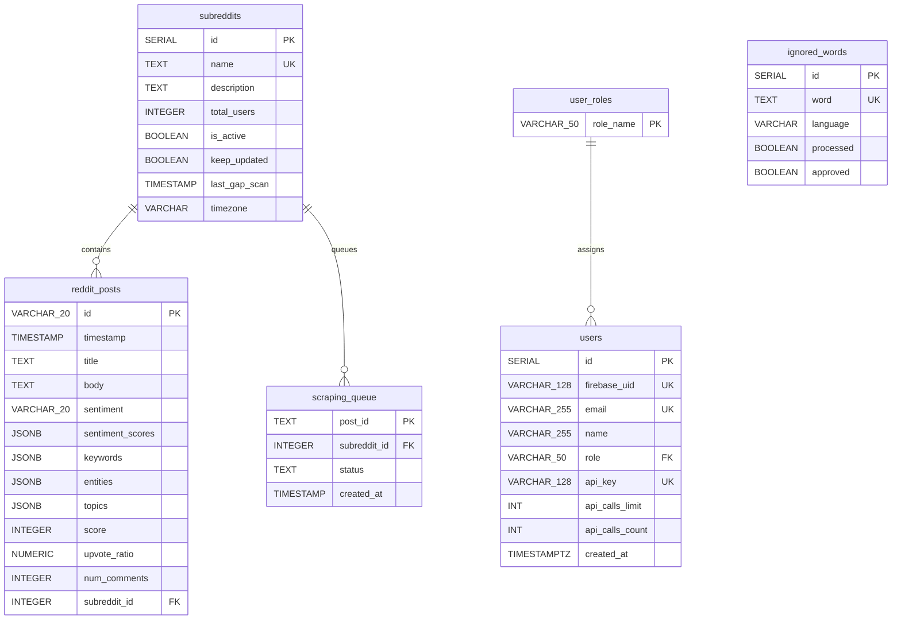
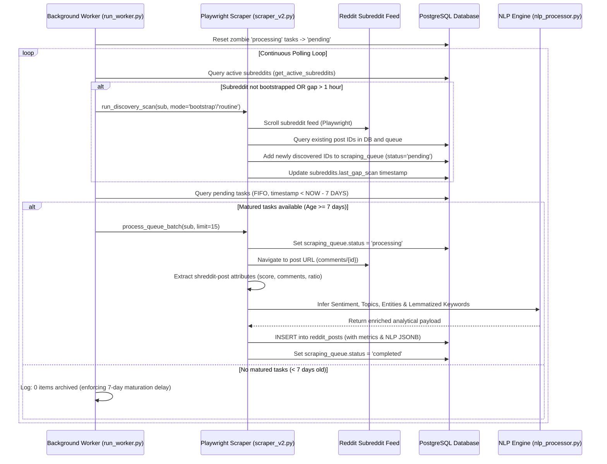

# Subreddit Analyzer - Complete Technical Documentation & AI Agent Guide

> [!IMPORTANT]
> **MANDATORY DIRECTIVE FOR ALL AI AGENTS & CONTRIBUTORS**
> 
> Whenever an AI agent or developer makes any change, fixes a bug, refactors code, updates dependencies, alters database schemas, adds new endpoints, or modifies scraping/NLP pipelines in this project, **YOU MUST UPDATE THIS FILE (`TECHNICAL_DOCUMENTATION.md`)** to reflect the exact state of the system, including modified files, updated functions, endpoints, database columns, and test coverage. Failure to update this document causes drift in subsequent AI reasoning cycles and breaks automated verification.

---

## 1. Project Overview & Philosophy

**Subreddit Analyzer** is an enterprise-grade civic data mining, empirical natural language processing (NLP), and analytical visualization platform. It continuously harvests, filters, enriches, and statistically analyzes community discussions across municipal and regional subreddits (e.g., `r/berlin`, `r/munich`, `r/nyc`, `r/london`, `r/amsterdam`, `r/singapore`, `r/toronto`, `r/losangeles`).

The platform was developed to support academic research into civic sentiment dynamics, topic friction, urban mobility concerns, and housing discourse, culminating in empirical hypothesis testing for a Master's Thesis.

### Core Capabilities:
- **Playwright Headless Ingestion**: Bypasses Reddit API limitations and rate locks via automated browser sessions (`scraper_v2.py`). Enforces a strict **7-day maturity delay** on scraped posts to guarantee that community engagement metrics (`score`, `upvote_ratio`, `num_comments`) have stabilized before archival.
- **Multilingual Neural NLP Stack**:
  - **Sentiment Analysis**: Cardiff NLP's multilingual `twitter-xlm-roberta-base-sentiment` model producing granular 3-class probability distributions (`positive`, `neutral`, `negative`).
  - **Zero-Shot Topic Classification**: Moritz Laurer's multilingual `mDeBERTa-v3-base-mnli-xnli` classifying posts into 29 civic taxonomy categories (housing, public transit, city administration, local economy, and safety).
  - **Named Entity Recognition (NER)**: SpaCy pipelines (`en_core_web_sm` and `xx_ent_wiki_sm`) extracting 16 entity categories (`PERSON`, `ORG`, `GPE`, `LOC`, `MONEY`, `LAW`, etc.).
  - **Lexical Mining**: NLTK tokenization, stopword removal, and WordNet lemmatization cross-referenced with a dynamic database-driven ignored-word blacklist.
- **Empirical KPI & Hypothesis Engine**: Aggregates time-series metrics (daily, weekly, monthly) with Simple Moving Averages (SMA), Shannon entropy of topic ambiguity, entity density moderations, and evaluates 7 formal academic hypotheses (`H1`–`H7`).
- **Real-Time WebSocket Orchestration**:
  - `/ws/ticket` and `/ws/reanalyze`: Short-lived ticket-authenticated WebSocket connection facilitating real-time NLP reanalysis across existing database records with interactive `start`, `pause`, `resume`, and `stop` controls.
  - `/ws/queue`: Live PostgreSQL `LISTEN/NOTIFY` stream broadcasting background queue changes and task state counts to connected clients.
- **Dual-Track Authentication & Metering**:
  - **Track A (Developer Scripts)**: Static API keys prefixed with `alfaz_live_...` with enforced per-account rate limits (`api_calls_limit` and `api_calls_count`).
  - **Track B (Human Dashboard)**: Firebase Authentication JWT tokens mapped to a PostgreSQL `users` table supporting four distinct Role-Based Access Control (RBAC) tiers: `Super Admin`, `Admin`, `Developer`, and `Guest User`.
- **Reactive Analytical Frontend**: Modern React 19 single-page application built with TypeScript, Chakra UI v3, Redux Toolkit, TanStack Query v5, Apache ECharts, and Chart.js.

---

## 2. High-Level Architecture & Execution Model

```mermaid
flowchart TD
    subgraph Client_Layer["Frontend Application (React 19 + TypeScript)"]
        UI["Chakra UI v3 / TanStack Query v5"]
        Redux["Redux Toolkit (store/index.js)"]
        Charts["Apache ECharts & Chart.js"]
        Auth["Firebase Auth SDK Client"]
    end

    subgraph Gateway_Layer["API Gateway (FastAPI + Uvicorn)"]
        Router["FastAPI Router Layer (run_api.py:8000)"]
        AuthGuard["Auth Guard: Firebase JWT & API Key Quota (auth_guard.py)"]
        WSTicket["WebSocket Ticket & Reanalyze Manager (routes_reanalyze.py)"]
        WSQueue["Queue Streamer: LISTEN/NOTIFY (routes_queue.py)"]
    end

    subgraph Worker_Layer["Scraping & NLP Worker Engine"]
        Worker["Background Worker Loop (run_worker.py)"]
        PlaywrightScraper["Playwright Headless Scraper (scraper_v2.py)"]
        NLPEngine["Transformer & SpaCy Pipelines (nlp_processor.py)"]
        RichDashboard["Rich Terminal Live Dashboard (shared_ui.py)"]
    end

    subgraph Storage_Layer["Persistence & Message Matrix"]
        PG[("PostgreSQL 15+ (reddit-scrapper)")]
        PG_Pool["AsyncPG Connection Pool (database/core.py)"]
        PG_Notify["PostgreSQL LISTEN/NOTIFY ('queue_updates')"]
        FB_Admin["Firebase Admin SDK (firebase_creds.json)"]
    end

    Client_Layer <-->|REST HTTP & WebSockets| Gateway_Layer
    Gateway_Layer -->|Validate Tokens| FB_Admin
    Gateway_Layer -->|Async Queries & Aggregations| PG_Pool
    PG_Notify -.->|Push Notifications| WSQueue
    Worker_Layer -->|Read/Write Tasks & Posts| PG_Pool
    Worker_Layer -->|Headless Scraping (7-day delay)| PlaywrightScraper
    PlaywrightScraper -->|Extract Texts & Metrics| NLPEngine
    NLPEngine -->|XLM-RoBERTa / DeBERTa / spaCy| PlaywrightScraper
    Worker -->|Console Monitoring| RichDashboard
    PG_Pool <--> PG
```

### Execution Contexts & Subsystems:
1. **Frontend Client (`localhost:5173` / `192.168.x.x:5173`)**:
   - Built with Vite. Consumes public `/summary`, `/kpis/series`, `/posts`, and `/posts/frequency` endpoints.
   - TanStack Query v5 manages aggressive caching and request deduplication. Redux manages current selection state (`userInputState`, `serverStatusState`, `authState`).
2. **API Server Gateway (`0.0.0.0:8000`)**:
   - FastAPI application powered by `uvicorn`. Connects to PostgreSQL via an `asyncpg` connection pool (minimum 5, maximum 20 connections).
   - Enforces RBAC on admin mutations, scrubs ignored words from historical records upon approval, and dispatches WebSocket feeds.
3. **Background Worker Daemon (`run_worker.py`)**:
   - Independent background daemon running alongside the API.
   - Clears "zombie" tasks stuck in `processing` state on reboot.
   - Continuously iterates over active subreddits: executes initial bootstrap sweeps, triggers routine gap scans if data is older than 1 hour, and archives matured posts (FIFO, minimum 7 days old) in batches.
4. **Offline / Fast-Inference ML Engine (`nlp_processor.py`)**:
   - Hugging Face Transformers models configured for offline execution (`HF_HUB_OFFLINE=1`, `TRANSFORMERS_OFFLINE=1`).
   - Automatically utilizes NVIDIA CUDA GPU (`float16` precision) when available, falling back to CPU (`float32`) if `FORCE_CPU=1` or when CUDA is unavailable.

---

## 3. Exhaustive Directory & File Breakdown

### 3.1. Project Root & Configuration Files

| File Path | Description & Purpose |
| :--- | :--- |
| `package.json` | Project manifest declaring dependencies (`react`, `react-dom`, `@chakra-ui/react`, `@reduxjs/toolkit`, `@tanstack/react-query`, `echarts`, `chart.js`, `firebase`, `react-markdown`, `remark-gfm`), dev tooling (`vite`, `vitest`, `playwright`, `typescript`, `eslint`), and npm scripts (`dev`, `build`, `test`, `test:e2e`, `typecheck`). |
| `package-lock.json` | Exact lockfile ensuring reproducible frontend dependencies. |
| `vite.config.ts` | Vite bundler and Vitest configuration with `@` path alias mapped to `./src`. |
| `tsconfig.json` | Root TypeScript configuration referencing app and node tsconfigs. |
| `tsconfig.app.json` | Compiler configuration targeting ES2020 for the browser client. |
| `tsconfig.node.json` | Compiler configuration for build scripts and configuration files. |
| `eslint.config.js` | ESLint 10 flat configuration enforcing React Hooks and React Refresh rules. |
| `playwright.config.ts` | Playwright test configuration targeting Chromium E2E specs on port 4173 with auto-managed web server lifecycle. |
| `firebase.json` | Firebase CLI deployment configuration for hosting static build artifacts (`dist`). |
| `.firebaserc` | Firebase project mapping targeting production deployment. |
| `firebase_config.js` | Client-side Firebase configuration initializing Firebase App and Firebase Auth. Implements privacy consent gating helpers (`hasAnalyticsConsent`, `initAnalyticsIfConsented`, `logCurrentPageView`, `disableAnalytics`) with `measurementId` (`G-YYPYW7SSGM`) ensuring `getAnalytics(app)` is never executed without explicit user opt-in consent. |
| `PRIVACY.md` | Comprehensive GDPR and German TDDDG (§ 25) privacy policy document defining data controller identity, academic research legal grounds (Art. 6(1)(f) & Art. 89), data minimization, local NLP architecture, author right to erasure (Art. 17), infrastructure logs, and opt-in analytics. Single source of truth rendered dynamically on the `/privacy` web route. |
| `PrivacyPolicy.md` | Exact root reference copy of `PRIVACY.md` with structured bullet lists, bold operational keys, and numbered statutory procedures. |
| `index.html` | SPA entry point mounting the root `<div id="root">`. |
| `Changelogs.md` | Architectural changelog tracking major frontend and backend milestones. |
| `README.md` | User-facing documentation detailing setup instructions, technology stack badges, and analytical dashboard screenshots. |
| `AboutProject.md` | Comprehensive GitHub and distribution documentation detailing Master's Thesis research, hypothesis specifications, architectural pipeline, terminology glossary, and technology stack. |
| `TECHNICAL_DOCUMENTATION.md` | **(This file)** Complete technical reference, database schemas, API specs, and AI contributor guide. |

---

### 3.2. Frontend Application & State Core (`src/`)

| File Path | Description & Purpose |
| :--- | :--- |
| `src/main.tsx` | Client application entry point. Wraps `App` with `ChakraUIProvider` and Redux `Provider`. |
| `src/App.tsx` | Main application shell. Sets up `react-router-dom` routes (`/`, `/about`, `/privacy`, `/login`, `/dashboard`), initializes public `/summary` telemetry check, and listens for auth changes via `Unsubscribe`. |
| `src/App.css` | Global styling and application layout overrides. |
| `src/index.css` | Base typography and CSS reset rules. |
| `src/vite-env.d.ts` | TypeScript declarations for Vite client environment and raw Markdown imports (`*.md?raw`). |
| `src/store/index.js` | Redux store configuration combining `userInput`, `serverStatus`, and `authState` reducers. |
| `src/store/authSlice.js` | Authentication slice managing user session (`isAuth`, `token`, `role`, `user` profile, and token refresh timer). |
| `src/store/serverStatus.js` | Server health slice tracking backend status (`online` vs `offline`) and caching `/summary` statistics. |
| `src/store/userInput.js` | Community filter slice managing selected `subredditID`, `subredditName`, `targetPostCount`, and `useOnlyCache`. |
| `src/util/constants.ts` | Central frontend constants: `BASE_URL` (`http://192.168.0.246:8000` in dev, `https://api.theonlyalfaz.com` in prod), `wsUrl`, `SENTIMENT_FILTER_CONFIG`, `TOPICS_CONFIG`, `ADMIN_USER_ROLES`, and theme variables. |
| `src/util/api.ts` | TanStack Query client, HTTP fetch wrapper (`fetchingData`), WebSocket builder (`buildWebSocketUrl`), and Firebase auth header interceptor (`createAuthHeaders`). |
| `src/util/Types.ts` | Comprehensive TypeScript interfaces and types for posts, keywords, KPIs, hypotheses, user records, and API responses. |
| `src/util/analytics.ts` | Client-side aggregation and data transformation helpers for charts and tables. |
| `src/util/analyticsConsent.ts` | GDPR and German TDDDG (§ 25) consent management module handling `localStorage` persistence (`analytics_consent`), event dispatching (`analytics-consent-change`, `open-analytics-consent`), and the `useAnalyticsConsent` React hook. |
| `src/util/dateTime.ts` | Date and timezone formatting utilities for synchronized local display. |
| `src/data/aboutContent.ts` | Single typed source of truth for the About Project page: thesis metadata (frozen snapshot $N = 51,587$), author facts (Alfaz Khan), research question, platform tab walkthrough, 6-step architecture, data cleaning specs, H1–H7 definitions & snapshot metrics, reading results guidance, 34 glossary items, limitations & ethics, and categorized tech stack. |
| `src/constants/Hypothesis-Content.json` | Academic formulations, titles, and interpretations for hypotheses `H1` through `H7`. |
| `src/constants/exhaustiveEChartsOption.js` | Base theme configuration and layout templates for Apache ECharts visualizations. |

---

### 3.3. Frontend Components & Views (`src/components/`)

| File Path | Description & Purpose |
| :--- | :--- |
| `src/components/Pages/Homepage/Homepage.tsx` | Main civic dashboard page hosting subreddit selection header, metrics banner, and the `DataTabs` analytics suite. |
| `src/components/Pages/Homepage/Navbar.tsx` | Top navigation bar with branding, route links (`/about`, `/privacy`, `/dashboard`), server status indicator badge, login/dashboard action, and persistent `Footer` integration. |
| `src/components/Pages/Homepage/UserInput.tsx` | Subreddit search, autocomplete selection input, and post target count controls. |
| `src/components/Pages/Homepage/SubredditsSummary.tsx` | Metric cards summarizing tracked subreddits, total post volume, and latest sync dates. |
| `src/components/Pages/Homepage/SubredditsSuggestion.tsx` | Quick-select pills displaying popular civic subreddits. |
| `src/components/Pages/Homepage/ErrorElement.tsx` | React Router error boundary view handling unexpected application crashes. |
| `src/components/Pages/Privacy/PrivacyPolicy.tsx` | Dedicated `/privacy` route view dynamically rendering `PRIVACY.md` via `react-markdown` and `remark-gfm` styled with Chakra UI v3 components. Includes a "Manage Analytics Preferences" button. |
| `src/components/Pages/Privacy/ConsentBanner.tsx` | GDPR and German TDDDG (§ 25) compliant opt-in consent banner. Presents "Accept Analytics" and "Reject" buttons with equal visual prominence (no dark patterns) and links to `/privacy`. |
| `src/components/Pages/Homepage/Data/DataTabs.tsx` | Primary 8-tab container managing views: `KPIs`, `Sentiments`, `WordCloud`, `Pie Chart`, `Posts Table`, `Keyword Table`, `Posts Frequency`, and `Sentiments Frequency`. |
| `src/components/Pages/Homepage/Data/Sentiment.tsx` | Sentiment distribution cards, percentage bars, and category breakdown. |
| `src/components/Pages/Homepage/Data/KeywordsPieChart.tsx` | Apache ECharts interactive donut and pie chart visualizing top extracted keywords and sentiment associations. |
| `src/components/Pages/Homepage/Data/KeywordsWordCloud.tsx` | Visual word cloud rendering keyword prominence scaled by frequency. |
| `src/components/Pages/Homepage/Data/KeywordTable.tsx` | TanStack table displaying extracted keywords, frequencies, sentiment breakdown, and word ignore reporting actions. |
| `src/components/Pages/Homepage/Data/PaginatatedPostTable.tsx` | Cursor-paginated post explorer displaying title, body snippet, metrics, sentiment, entities, and primary topics. |
| `src/components/Pages/Homepage/Data/PostTableFilters.tsx` | Filter bar for the post table (sentiment, topic, search query, date ranges). |
| `src/components/Pages/Homepage/Data/PostsFrequency.tsx` | 24-hour diurnal chart plotting post submission activity by hour of day in the subreddit's local timezone. |
| `src/components/Pages/Homepage/Data/EmotionsThroughoutDay.tsx` | 24-hour diurnal chart plotting sentiment ratios (positive, neutral, negative) across the day in local time. |
| `src/components/Pages/Homepage/Data/Hypothesis/KPIAnalytics.tsx` | Master thesis KPI analytics dashboard combining the interactive time-series chart and hypothesis tabs. |
| `src/components/Pages/Homepage/Data/Hypothesis/KPIAnalyticsChart.tsx` | Dual-axis ECharts time-series displaying post count, sentiment SMAs, upvote ratios, and topic volumes across time. |
| `src/components/Pages/Homepage/Data/Hypothesis/HypothesisTabs.tsx` | Sequential tab system (`H1` to `H7`) fetching individual academic hypothesis statistical tests with TanStack Query. |
| `src/components/Pages/Homepage/Data/Hypothesis/HypothesisContent.tsx` | Content renderer displaying formal academic formulations, p-values, t-statistics, correlation coefficients, and interpretations. |
| `src/components/Pages/Homepage/Data/Hypothesis/KPIHelpers.tsx` | Data transformation and normalization helpers for KPI time-series and hypothesis payloads. |
| `src/components/Pages/Admin Dashboard/AdminDashboard.tsx` | Administrative dashboard with RBAC tab controls (`Subreddits`, `Ignored Words`, `Processes`, `Reanalyze`, and `Manage Users`) and persistent `Footer`. |
| `src/components/Pages/Admin Dashboard/SubredditsSection.tsx` | Subreddit management table (add new subreddit, toggle active/keep_updated, set timezone, view counts). |
| `src/components/Pages/Admin Dashboard/ProcessQueueSection.tsx` | Real-time monitoring of `scraping_queue` via `/ws/queue` with retry and re-scrape triggers. |
| `src/components/Pages/Admin Dashboard/ReanalyzeSection.tsx` | Interactive UI to run real-time re-NLP passes over historical data via WebSocket ticket. |
| `src/components/Pages/Admin Dashboard/Ignored-Words/IgnoredWordsSection.tsx` | Table of pending and approved ignored words with approve, reject, and delete actions. |
| `src/components/Pages/Admin Dashboard/Users/UsersSection.tsx` | User management table (create user, edit roles, adjust rate limits, generate/rotate API keys). |
| `src/components/Pages/Authentication/Login.tsx` | Firebase Authentication login page supporting email/password sign-in, with persistent 1-click access to the Privacy Policy and Cookie Settings via `Footer`. |
| `src/components/Pages/ProtectedRoute.tsx` | React Router guard checking user authentication and RBAC roles before rendering admin routes. |
| `src/components/Pages/AboutProject/AboutProject.tsx` | Master's Thesis informational portal shell assembling single `h1`, responsive two-column layout (~70ch prose + sticky `PageToc`), and all section components in exact required order. |
| `src/components/Pages/AboutProject/AuthorThesisSection.tsx` | Header banner with academic metadata (MBA General Management, ISM Munich), The Question, author persona for Alfaz Khan, thesis as research instrument, and 3 core research contributions. |
| `src/components/Pages/AboutProject/PlatformSection.tsx` | Guided walkthrough of the 8 real dashboard tabs using screenshots with captions, lazy loading, and accessible click-to-enlarge lightbox modal. |
| `src/components/Pages/AboutProject/SystemArchitectureSection.tsx` | Hand-built inline SVG pipeline diagram and 6-step breakdown verified against backend code. |
| `src/components/Pages/AboutProject/DataMethodSection.tsx` | 7-day maturity delay rationale, stored vs excluded fields, cleaning filters ($N = 51,587$), dynamic city list, and local offline NLP models. |
| `src/components/Pages/AboutProject/Hypotheses/HypothesesSection.tsx` | Interactive explorer for the seven academic hypotheses (`H1`–`H7`) grouped across the four research pillars, with accordion Expand/Collapse all controls and live KPI link. |
| `src/components/Pages/AboutProject/Hypotheses/HypothesisCard.tsx` | Modular hypothesis card presenting formal academic statement, theoretical motivation, operationalized variables, method rationale, snapshot results, verdicts (`Supported`, `Supported, small effect`, `Inconclusive`), and embedded ECharts (H1, H5, H6, H7). |
| `src/components/Pages/AboutProject/ReadingResultsSection.tsx` | Statistical guidance explaining p-values, large sample size effects, effect sizes, and correlation vs causation, featuring the two honest empirical examples. |
| `src/components/Pages/AboutProject/TerminologySection.tsx` | Alphabetical, searchable glossary defining 34 mathematical, NLP, and civic terms with formal equations and anchor IDs (`#glossary-${id}`). |
| `src/components/Pages/AboutProject/GlossaryTerm.tsx` | Accessible inline term component with dotted underline, `tabIndex={0}`, accessible tooltip, and smooth scrolling to glossary entry. |
| `src/components/Pages/AboutProject/LimitationsEthicsSection.tsx` | Methodological limitations bullets, research ethics, Art. 17 GDPR erasure, link to `/privacy`, and `TODO_ALFAZ:` for Reddit TOS. |
| `src/components/Pages/AboutProject/TechStackSection.tsx` | Compact 2-column table categorized across Frontend, Backend, NLP, Data, and Hosting/Testing from `package.json` and `Scraping/requirements.txt`. |
| `src/components/Pages/AboutProject/PageToc.tsx` | Sticky semantic `<nav aria-label="Table of contents">` with scroll-spy on desktop, compact native select on mobile. |
| `src/components/Pages/AboutProject/AboutProject.test.tsx` | Unit and integration test suite (16 tests) validating component rendering, lightbox interactions, and verbatim consistency with `AboutProject.md`. |
| `src/components/ui-components/Footer.tsx` | Persistent site-wide footer component rendered across all pages, providing 1-click links to `Privacy Policy`, `Cookie Settings` trigger, `About Project`, and mounting `ConsentBanner`. |
| `src/components/ui-components/*` | Reusable UI building blocks: Chakra primitives, modals/dialogs, feedbacks/spinners, form controls, tables, and charts. |

---

### 3.4. Backend API Gateway & Routing (`Scraping/` & `Scraping/Routes/`)

| File Path | Description & Purpose |
| :--- | :--- |
| `Scraping/run_api.py` | **Main API Server Entry Point**. Initializes FastAPI application, mounts CORS middleware with allowed local and network origins, attaches all route controllers, and boots Uvicorn on port 8000. |
| `Scraping/auth_guard.py` | **Authentication & Security Middleware**. Implements dual-track interceptor (`verify_client_identity`): validates API keys against PostgreSQL (`users.api_key`) with rate-limit metering, or verifies Firebase Bearer JWTs and synchronizes with DB profiles. Provides RBAC enforcement via `require_role(...)`. |
| `Scraping/Routes/routes_posts.py` | **Posts Controller**. Endpoints for cursor-paginated post browsing (`/posts`), public telemetry summary (`/summary`), keyword aggregation (`/posts/keywords`), keyword occurrences (`/posts/keywords/{word}`), diurnal local frequency (`/posts/frequency`), and post CRUD. |
| `Scraping/Routes/routes_subreddits.py` | **Subreddits Controller**. Endpoints for listing, registering, updating, and deleting tracked subreddits (`/subreddits`), as well as sentiment aggregates (`/subreddits/sentiments`). |
| `Scraping/Routes/routes_kpis.py` | **KPI & Hypothesis Controller**. Serves time-series KPI charts (`/kpis/series`) and computes academic statistical tests (`/kpis`, `/kpis/h1` through `/kpis/h7`). |
| `Scraping/Routes/routes_reanalyze.py` | **Reanalysis WebSocket Controller**. Issues short-lived tickets (`POST /ws/ticket`) and manages live WebSocket session (`WS /ws/reanalyze`) for running batch re-NLP pipelines with progress events. |
| `Scraping/Routes/routes_users.py` | **User Management Controller**. Manages users transactionally across Firebase Auth and PostgreSQL (`/users/create`, `/users/{user_id}`, `/users/generate-api-key`, `/users/me`). |
| `Scraping/Routes/routes_ignored_words.py` | **Ignored Words Controller**. Manages stopword blacklists (`/ignored-words`), atomic keyword purging upon word approval, and word submission. |
| `Scraping/Routes/routes_queue.py` | **Scraping Queue Controller**. Exposes queue state (`/queue`), manual re-scrape triggers, and real-time WebSocket stream (`WS /ws/queue`) backed by PostgreSQL `LISTEN/NOTIFY`. |

---

### 3.5. Scraping & NLP Worker Pipeline (`Scraping/`)

| File Path | Description & Purpose |
| :--- | :--- |
| `Scraping/run_worker.py` | **Background Worker Orchestrator**. Runs the continuous scraping loop, resets zombie `processing` tasks to `pending`, runs bootstrap or routine gap scans, retries failed tasks, and processes FIFO matured tasks older than 7 days. |
| `Scraping/scraper_v2.py` | **Playwright Scraper Engine**. Headless Chromium browser automation. Discovers posts from subreddit feeds, checks existing database and queue records, enforces 7-day maturity delay, extracts `shreddit-post` DOM metrics (score, comments, upvote ratio), invokes NLP pipelines, and persists to PostgreSQL. |
| `Scraping/nlp_processor.py` | **Multilingual NLP Inference Engine**. Loads lazy pipelines for sentiment analysis (`twitter-xlm-roberta-base-sentiment`), 29-class zero-shot topic classification (`mDeBERTa-v3-base-mnli-xnli`), SpaCy NER (`en_core_web_sm` / `xx_ent_wiki_sm`), and NLTK lemmatization. |
| `Scraping/scan_complete_feed.py` | Standalone utility script to perform deep historical sweeps across a target subreddit feed. |
| `Scraping/refresh_keywords_bg.py` | Background utility script for re-extracting keywords across existing database post records. |
| `Scraping/shared_ui.py` | Terminal dashboard manager using `rich.live` to display real-time scraping metrics, current subreddit, queue counts, and database totals. |
| `Scraping/config.py` | Database connection parameters (`DB_HOST`, `DB_PORT`, `DB_NAME`, `DB_USER`, `DB_PASSWORD`), concurrency semaphores, and scraping intervals. |
| `Scraping/docker-compose.yml` | Container specification mapping host port `8050:8000` with NVIDIA GPU device passthrough and Hugging Face volume cache. |
| `Scraping/requirements.txt` | Python dependency manifest (`fastapi`, `uvicorn`, `playwright`, `torch`, `transformers`, `spacy`, `nltk`, `asyncpg`, `firebase-admin`, `rich`, `pytest`). |
| `Scraping/setup.sh` | Shell script provisioning virtual environment, Playwright Chromium, spaCy models, NLTK lexicons, and caching Hugging Face model weights. |

---

### 3.6. Database Persistence Layer & Migrations (`Scraping/database/` & `Scraping/Migrations/`)

| File Path | Description & Purpose |
| :--- | :--- |
| `Scraping/database/core.py` | Initializes and manages the global `asyncpg` connection pool with connection recycling and error handling. |
| `Scraping/database/posts.py` | Database queries for post ingestion, cursor-paginated retrieval, sentiment aggregation, diurnal frequency calculation, and post updates. |
| `Scraping/database/subreddits.py` | Database queries for tracking subreddits, bootstrapping status, last gap scan timestamps, and timezone configurations. |
| `Scraping/database/kpis.py` | Core statistical calculations for time-series aggregation, SMAs, topic distribution entropy, entity density moderation, and hypotheses `H1`–`H7`. |
| `Scraping/database/queue_manager.py` | Low-level queue management functions: insert tasks, transition task status (`pending`, `processing`, `completed`, `failed`), and query matured tasks. |
| `Scraping/database/queue.py` | High-level queue aggregation queries for the admin dashboard and WebSocket broadcaster. |
| `Scraping/database/users.py` | Queries for user profile retrieval by UID or API key, quota incrementing, and API key rotation. |
| `Scraping/database/ignored_words.py` | Stopword management queries, word insertion, approval toggling, and atomic scrubbing of approved words from `reddit_posts.keywords`. |
| `Scraping/migrate.py` | Migration runner script applying pending SQL migration scripts sequentially. |
| `Scraping/Migrations/0001_initial_schema.sql` | Initial tables: `subreddits`, `scraping_queue`, `reddit_posts`, `ignored_words`. |
| `Scraping/Migrations/0002_add_keep_updated_column.sql` | Adds `keep_updated` boolean flag to `subreddits`. |
| `Scraping/Migrations/0003_refactor_queue_and_ignored_words.sql` | Converts `scraping_queue.subreddit` to foreign key `subreddit_id` and decouples `ignored_words` into a global table. |
| `Scraping/Migrations/0004_populate_ignored_words.sql` | Seeds initial English stopwords (NLTK + spaCy + scikit-learn) with a unique word index. |
| `Scraping/Migrations/0005_add_topics_to_posts.sql` | Adds `topics` JSONB column to `reddit_posts` and creates GIN index on `primary_topic`. |
| `Scraping/Migrations/0006_add_fields_to_ignored_words.sql` | Adds `language`, `processed`, and `approved` flags to `ignored_words`. |
| `Scraping/Migrations/0007_create_users_table.sql` | Creates `user_roles` and `users` tables with `api_key` lookup index and rate limiting columns. |
| `Scraping/Migrations/0008_create_sentiment_score_column.sql` | Adds `sentiment_scores` JSONB column to `reddit_posts`. |
| `Scraping/Migrations/0009_adding_triggers_for_scrapping_queue.sql` | Creates PostgreSQL function `notify_queue_change()` and trigger on `scraping_queue` executing `pg_notify('queue_updates', ...)`. |
| `Scraping/Migrations/0010_add_keywords_gin_index.sql` | Adds GIN index `idx_reddit_posts_keywords_gin` on `reddit_posts.keywords` for fast keyword queries and purging. |
| `Scraping/Migrations/0011_add_metrics_columns.sql` | Adds `score`, `upvote_ratio`, and `num_comments` metrics to `reddit_posts`. |
| `Scraping/Migrations/0012_index_for_global_cursor_pagination.sql` | Adds composite B-Tree indexes on `(timestamp DESC, id DESC)` for fast global and subreddit cursor pagination. |
| `Scraping/Migrations/0013_adding_timestamp_to_subreddits.sql` | Adds `timezone` column to `subreddits` and maps initial municipal subreddits to local timezones. |

---

### 3.7. Testing Suite (`tests/` & `Scraping/tests/`)

| File Path | Description & Purpose |
| :--- | :--- |
| `tests/setup.ts` | Frontend test setup for Vitest with `@testing-library/jest-dom` extensions. |
| `tests/e2e/app.spec.ts` | Playwright E2E test verifying homepage rendering, tab navigation, and search interaction. |
| `tests/e2e/api.smoke.spec.ts` | Playwright smoke test validating backend REST endpoints availability and response schemas. |
| `src/util/http.test.ts` | Unit tests for API client helper functions and authentication interceptors. |
| `src/util/utilities.test.ts` | Unit tests for frontend data parsing, date normalization, and formatters. |
| `src/components/Pages/Homepage/Data/DataTabs.test.tsx` | Unit tests for data tab switching and lazy mounting behaviors. |
| `src/components/Pages/Homepage/Data/Hypothesis/KPIAnalyticsChart.test.tsx` | Unit tests for KPI ECharts options generation and time-series series mapping. |
| `src/components/ui-components/ui-components.test.tsx` | Unit tests for Chakra UI wrapper components, dialogs, and feedback primitives. |
| `Scraping/pytest.ini` | Pytest configuration file with `asyncio_mode = auto`. |
| `Scraping/tests/conftest.py` | Pytest fixtures providing test database pools, mock auth tokens, and test client configurations. |
| `Scraping/tests/test_auth_guard.py` | Tests for Firebase JWT decoding, API key rate limiting, and RBAC authorization blocks. |
| `Scraping/tests/test_database_core.py` | Tests for PostgreSQL connection pool initialization, acquisition, and reconnection. |
| `Scraping/tests/test_database_posts.py` | Tests for cursor-paginated post queries, diurnal frequency calculations, and keyword searches. |
| `Scraping/tests/test_database_kpis.py` | Tests for time-series KPI calculations and hypothesis statistical functions. |
| `Scraping/tests/test_routes.py` | FastAPI route tests validating status codes, response schemas, and error handlers. |
| `Scraping/tests/test_reanalyze.py` | Tests for WebSocket reanalysis ticket creation and state machine transitions. |
| `Scraping/tests/test_scraper.py` | Tests for Playwright metadata extraction, shreddit selector parsing, and 7-day maturity delay enforcement. |

---

## 4. PostgreSQL Database Schema & Relational Contract

The database runs on PostgreSQL 15+ with the relational schema managed via sequential SQL files in `Scraping/Migrations/`.



### Table Specifications & Indexing Strategy:

1. **`subreddits`**:
   - `id`: `SERIAL PRIMARY KEY`
   - `name`: `TEXT NOT NULL UNIQUE` (e.g., `'berlin'`, `'munich'`)
   - `description`: `TEXT`
   - `total_users`: `INTEGER` (subscriber count for scale-normalized analytics)
   - `is_active`: `BOOLEAN DEFAULT TRUE` (whether the worker includes it in routine sweeps)
   - `keep_updated`: `BOOLEAN DEFAULT FALSE` (priority flag for continuous monitoring)
   - `last_gap_scan`: `TIMESTAMP WITHOUT TIME ZONE`
   - `timezone`: `VARCHAR(64) DEFAULT 'UTC'` (e.g., `'Europe/Berlin'`, `'America/New_York'`)

2. **`reddit_posts`**:
   - `id`: `VARCHAR(20) PRIMARY KEY` (Reddit submission ID, stripped of `t3_` prefix)
   - `timestamp`: `TIMESTAMP WITHOUT TIME ZONE` (UTC submission timestamp)
   - `title`: `TEXT`
   - `body`: `TEXT`
   - `sentiment`: `VARCHAR(20)` (`'Positive'`, `'Neutral'`, `'Negative'`)
   - `sentiment_scores`: `JSONB` (`{"positive": 0.82, "neutral": 0.12, "negative": 0.06}`)
   - `keywords`: `JSONB` (`{"rent": 4, "apartment": 2}`)
   - `entities`: `JSONB` (`[{"text": "Senate", "label": "ORG"}]`)
   - `topics`: `JSONB` (`{"primary_topic": "Rent Prices & Affordability", "labels": [...], "scores": [...]}`)
   - `score`: `INTEGER DEFAULT 0`
   - `upvote_ratio`: `NUMERIC(4, 3) DEFAULT 0.000`
   - `num_comments`: `INTEGER DEFAULT 0`
   - `subreddit_id`: `INTEGER REFERENCES subreddits(id) ON DELETE SET NULL`
   - **Indexes**:
     - `idx_reddit_posts_cursor`: `(timestamp DESC, id DESC)` (global compound cursor pagination)
     - `idx_reddit_posts_sub_cursor`: `(subreddit_id, timestamp DESC, id DESC)` (subreddit compound cursor pagination)
     - `idx_reddit_posts_keywords_gin`: `USING gin ((keywords::jsonb))` (fast keyword filtering and atomic word purging)
     - `idx_posts_primary_topic`: `USING gin ((topics->'primary_topic'))` (fast topic filtering)

3. **`scraping_queue`**:
   - `post_id`: `TEXT PRIMARY KEY`
   - `subreddit_id`: `INTEGER NOT NULL REFERENCES subreddits(id) ON DELETE CASCADE`
   - `status`: `TEXT DEFAULT 'pending'` (`'pending'`, `'processing'`, `'completed'`, `'failed'`)
   - `created_at`: `TIMESTAMP WITHOUT TIME ZONE DEFAULT CURRENT_TIMESTAMP`
   - **Trigger**: `queue_changed_trigger` fires `notify_queue_change()` on any insert/update/delete, invoking `pg_notify('queue_updates', 'queue_changed')`.
   - **Index**: `idx_scraping_queue_sub_id_status` on `(subreddit_id, status)`

4. **`ignored_words`**:
   - `id`: `SERIAL PRIMARY KEY`
   - `word`: `TEXT NOT NULL UNIQUE` (lowercased lemma)
   - `language`: `VARCHAR(50) DEFAULT 'en'`
   - `processed`: `BOOLEAN DEFAULT FALSE`
   - `approved`: `BOOLEAN DEFAULT FALSE`

5. **`users` & `user_roles`**:
   - `user_roles`: Stores canonical roles: `'Super Admin'`, `'Admin'`, `'Guest User'`, `'Developer'`.
   - `users`: Maps Firebase UID to email, name, role, static `api_key` (`alfaz_live_...`), and rate metering columns (`api_calls_limit`, `api_calls_count`). Indexed on `api_key`.

---

## 5. REST & WebSocket API Contract

Base URL (Development): `http://192.168.0.246:8000`  
Base URL (Production): `https://api.theonlyalfaz.com`

| Method | Endpoint Path | Auth / Role | Description & Parameters |
| :--- | :--- | :--- | :--- |
| **GET** | `/summary` | Public | High-level summary of active subreddits, total post counts, and latest update timestamps. |
| **GET** | `/posts` | Public | Base64 compound cursor-paginated post stream. Query params: `limit` (1–100, default 20), `cursor` (str), `direction` (`next` \| `prev`), `subreddit` (str). |
| **GET** | `/posts/keywords` | Public | Aggregates database keywords with sentiment distribution. Query params: `subreddit` (str), `min_frequency` (int), `limit` (int, default 500). |
| **GET** | `/posts/keywords/{word}` | Public | Returns post IDs containing the given keyword. Query param: `subreddit` (optional). |
| **GET** | `/posts/frequency` | Public | 24-hour diurnal post and emotion frequency (`00:00`–`23:00`) aligned to subreddit local timezone. Query params: `subreddit`, `start_date`, `end_date`. |
| **PUT** | `/posts/{subreddit}/{post_id}` | `Super Admin` | Updates post metadata, sentiment, or NLP fields. |
| **DELETE** | `/posts/{subreddit}/{post_id}` | `Super Admin` | Permanently deletes a post record from PostgreSQL. |
| **GET** | `/subreddits` | Public | Lists all tracked subreddit configurations, subscriber counts, and timezones. |
| **GET** | `/subreddits/{name}` | Public | Fetches details for a single subreddit. |
| **GET** | `/subreddits/sentiments` | Public | Sentiment percentage and volume breakdown across subreddits. |
| **POST** | `/subreddits` | `Super Admin` | Registers a new tracked subreddit. Body: `{ "name", "description", "total_users", "is_active", "keep_updated", "timezone" }`. |
| **PUT** | `/subreddits/{name}` | `Super Admin` | Updates tracking flags, subscriber counts, or timezone. |
| **DELETE** | `/subreddits/{name}` | `Super Admin` | Removes a tracked subreddit configuration. |
| **GET** | `/kpis` | Public | Complete KPI payload including time-series buckets and all 7 academic hypothesis tests (`H1`–`H7`). |
| **GET** | `/kpis/series` | Public | Lightweight time-series endpoint for frontend chart rendering (bypasses hypothesis tests). |
| **GET** | `/kpis/h1` ... `/kpis/h7` | Public | Computes and returns an individual academic hypothesis statistical test with interpretation. |
| **POST** | `/ws/ticket` | `Super Admin` | Generates a single-use 30-second ticket UUID for authenticating the reanalysis WebSocket. |
| **WS** | `/ws/reanalyze?ticket={id}` | Ticket Required | Interactive WebSocket stream controlling real-time re-NLP passes (`start`, `pause`, `resume`, `stop`). |
| **GET** | `/queue` | Public | Returns scraping queue task counts (`pending`, `processing`, `completed`, `failed`) and priority items. |
| **PUT** | `/queue/{subreddit}/{post_id}` | `Super Admin` | Resets a queue item status back to `pending`. |
| **WS** | `/ws/queue` | Public | Real-time WebSocket broadcasting queue count updates triggered via PostgreSQL `LISTEN/NOTIFY`. |
| **GET** | `/ignored-words` | Public | Lists all dynamic ignored-word blacklist entries. |
| **POST** | `/ignored-words` | Public | Submits suggested words for review (`approved: false`). |
| **PUT** | `/ignored-words/{word}` | `Super Admin` | Approves or rejects a word. On approval, atomically scrubs the word from all existing `reddit_posts.keywords`. |
| **DELETE** | `/ignored-words/{word}` | `Super Admin` | Deletes an ignored-word record. |
| **POST** | `/users/create` | `Super Admin` | Creates a user in Firebase Auth and PostgreSQL transactionally. |
| **GET** | `/users/me` | Authenticated | Returns current user profile, role, and API usage stats. |
| **GET** | `/users` | `Super Admin` | Lists all registered users and quota consumption. |
| **PUT** | `/users/{user_id}` | `Super Admin` | Modifies user role, API quota limit, name, or password. |
| **DELETE** | `/users/{user_id}` | `Super Admin` | Deletes user from both PostgreSQL and Firebase Auth. |
| **POST** | `/users/generate-api-key` | Authenticated | Generates or rotates the user's `alfaz_live_...` API key. |

---

## 6. Execution Flows & Lifecycles

### 6.1. Discovery, Queueing & Matured Scraping Lifecycle



### 6.2. Multilingual NLP Pipeline Lifecycle

When raw post text (`f"{title} {body}"`) is processed:
1. **Device Resolution**: Evaluates CUDA availability. If an NVIDIA GPU is detected and `FORCE_CPU != 1`, models run on CUDA device `0` with `torch.float16` and `low_cpu_mem_usage=True`.
2. **Sentiment Analysis**:
   - Model: `cardiffnlp/twitter-xlm-roberta-base-sentiment`
   - Inputs are truncated to 512 tokens.
   - Outputs 3 probability floats (`positive`, `neutral`, `negative`). The highest probability determines the primary label (`Positive`, `Neutral`, or `Negative`).
3. **Zero-Shot Topic Classification**:
   - Model: `MoritzLaurer/mDeBERTa-v3-base-mnli-xnli`
   - Inputs truncated to 1024 tokens.
   - Evaluates text against 29 candidate civic labels (`CANDIDATE_LABELS`). Returns ranked labels and confidence scores, assigning `primary_topic = labels[0]`.
4. **Named Entity Recognition**:
   - Evaluated using SpaCy (`en_core_web_sm` with fallback to `xx_ent_wiki_sm`).
   - Filters recognized spans to 16 canonical categories (`SUPPORTED_ENTITY_LABELS`).
5. **Keyword Extraction & Stopword Scrubbing**:
   - Tokenized into lower-case alphanumeric terms with length > 2 via NLTK `word_tokenize`.
   - Filtered against English stopwords combined with dynamic database-approved `ignored_words`.
   - Lemmatized via WordNet Lemmatizer and stored as a JSON frequency dictionary (`Counter(clean)`).

### 6.3. Academic Hypothesis Engine (`H1` through `H7`)

The platform computes empirical hypothesis tests organized across 4 research pillars:
- **Pillar 1: Emotional Polarity & Discussion Dynamics**
  - **H1 (Negativity-Engagement Dynamic)**: Tests whether negative sentiment ($P_{neg}$) correlates positively with comment depth (`num_comments`) and negatively with approval (`upvote_ratio`).
  - **H2 (Polarization & Virality Dynamic)**: Tests whether emotional polarity magnitude $|P_{pos} - P_{neg}|$ correlates with higher net karma scores.
- **Pillar 2: Thematic Ambiguity & Structural Specificity**
  - **H3 (Topic Ambiguity vs. Clarity)**: Computes Shannon entropy across the 30-topic distribution ($H = -\sum_{i=1}^{30} p_i \ln(p_i)$ in natural log units / nats, verified from `calculate_shannon_entropy` in `Scraping/database/kpis.py`) and measures its penalizing effect on log-transformed karma scores ($\beta_1 = -0.5053, p < 0.001$).
  - **H4 (Entity Specificity & Consensus)**: Tests whether named entity density (`MONEY`, `ORG`, `GPE`, `LOC`) moderates the relationship between negative sentiment and consensus approval. In the thesis snapshot ($N = 51,587$), default SpaCy pipelines produced sparse entity extraction on non-English posts, resulting in a rank-deficient design matrix (result: inconclusive).
- **Pillar 3: Civic Friction vs. Cultural Lifestyle**
  - **H5 (Civic Friction vs. Lifestyle Consensus)**: Compares administrative/housing topics (8 topics) against cultural/lifestyle topics (7 topics) via Welch's t-test, confirming significantly elevated negative sentiment ($0.3842$ vs $0.3315, t = +5.98, p < 0.001$) and lower approval ($0.7356$ vs $0.7690, t = -5.42, p < 0.001$).
- **Pillar 4: Temporal & Scale-Normalized Dynamics**
  - **H6 (Diurnal & Temporal Affect Cycles)**: Evaluates local time-of-day submissions across four 6-hour windows aligned to municipal IANA timezones via one-way ANOVA ($F = 15.46, p = 4.76 \times 10^{-10}$). While the initial theoretical hypothesis predicted late-night grievance venting, empirical computation in `Scraping/database/kpis.py` across the thesis snapshot reveals Morning posts exhibit the highest negative sentiment ($0.3679$) and Night submissions the lowest ($0.3399$), with diurnal window explaining $< 0.1\%$ of sentiment variance ($\eta^2 < 0.001$).
  - **H7 (Scaled Community Virality & Lexical Diversity)**: Normalizes engagement against subreddit scale using $\text{Normalized Comments} = (\text{num\_comments} / \text{total\_users}) \times 10,000.0$ controlling for $\ln(1 + \text{total\_users})$, confirming a statistically significant inverted U-shape quadratic relationship between lexical Type-Token Ratio (TTR) and community comments ($\beta_1 = +1080.13, \beta_2 = -707.26, p < 0.001$, peak at $\text{TTR}^* \approx 0.764$).

---

## 7. Development, Build & Testing Guide

### 7.1. Essential CLI Commands

#### Frontend (Root Directory)
```bash
# Start Vite development server with LAN host exposure
npm run dev

# Run TypeScript compilation check without emitting files
npm run typecheck

# Run ESLint linter across the repository
npm run lint

# Build production bundle into /dist
npm run build

# Preview production build locally
npm run preview

# Execute all frontend unit tests with Vitest
npm test

# Run unit tests in interactive watch mode
npm run test:watch

# Execute Playwright End-to-End tests
npm run test:e2e

# Run Playwright API smoke tests
npm run test:api
```

#### Backend (Scraping Directory)
```bash
cd Scraping

# Activate Python virtual environment (Windows PowerShell)
.\venv\Scripts\Activate.ps1

# Activate Python virtual environment (Linux/macOS)
source .venv/bin/activate

# Apply all database migrations
python migrate.py

# Launch FastAPI REST Gateway on http://0.0.0.0:8000
python run_api.py

# Launch Background Scraping & NLP Worker with Rich Live Dashboard
python run_worker.py

# Run all backend unit and integration tests with Pytest
pytest

# Run tests with verbose output and immediate failure stop
pytest -v -x
```

### 7.2. Guidelines for Adding a New Tracked Subreddit

When onboarding a new civic subreddit to the platform:
1. **Timezone Identification**: Determine the city or region's IANA timezone identifier (e.g., `'Europe/Vienna'`, `'America/Chicago'`).
2. **Database Registration**:
   - Option A (Admin Dashboard UI): Navigate to `/dashboard` -> **Subreddits** tab -> enter the name, description, subscriber count, and timezone -> click **Add Subreddit**.
   - Option B (REST API): Send `POST /subreddits` with a `Super Admin` bearer token.
3. **Bootstrap Sweep**:
   - The background worker will automatically detect `is_bootstrapped = false` on its next iteration and initiate `run_discovery_scan(subreddit, mode='bootstrap')`.
   - Discovered submission IDs are queued into `scraping_queue`.
4. **Maturation Window**:
   - Posts discovered from recent days will remain in `pending` state until their publication date exceeds the **7-day maturity delay**.
   - Older historical posts will be ingested and processed immediately in FIFO batches.

### 7.3. Guidelines for Modifying Database Schemas

1. **Create Migration Script**:
   - Add a sequential SQL file in `Scraping/Migrations/` following the naming convention:
     `Scraping/Migrations/0014_<descriptive_name>.sql`
   - Use idempotent statements (`ADD COLUMN IF NOT EXISTS`, `CREATE INDEX IF NOT EXISTS`).
2. **Apply Migration**:
   - Execute `python Scraping/migrate.py`.
3. **Update Database Layer**:
   - Update SQL queries in `Scraping/database/<domain>.py`.
4. **Update Frontend Types**:
   - Update interfaces in `src/util/Types.ts`.
5. **Update Technical Documentation**:
   - **Immediately update this document (`TECHNICAL_DOCUMENTATION.md`)** with the new schema columns and indexing strategies.

---

## 8. GDPR & German TDDDG (§ 25) Privacy Compliance Architecture

The Subreddit Analyzer implements a rigorous privacy-by-design framework adhering to the European Union General Data Protection Regulation (GDPR - Regulation (EU) 2016/679) and the German Telecommunications-Telemedia Data Protection Act (TDDDG - Telekommunikation-Digitale-Dienste-Datenschutz-Gesetz, § 25).

### 8.1. Data Controller & Academic Scope
- **Data Controller**: Alfaz Khan (Location: Munich, Bavaria, Germany; Contact: `khanalfaaz14@gmail.com`).
- **Research Context**: Non-commercial academic research platform in support of a Master's Thesis investigating municipal discourse, sentiment trends, and topic distributions in civic subreddits.
- **Production Host**: `https://subanalyzer.theonlyalfaz.com`.

### 8.2. Public Reddit Data Collection & Safeguards (Art. 6(1)(f) & Art. 89 GDPR)
- **Legal Grounds**: Legitimate Interest (Art. 6(1)(f) GDPR) in conjunction with scientific and statistical research safeguards (Art. 89 GDPR and Section 27 German BDSG).
- **7-Day Observation Window**: Submissions are only ingested after a 7-day maturity delay to respect author deletions and community moderation lifecycles.
- **Data Minimization (Art. 5(1)(c) GDPR)**:
  - **Collected Fields**: Reddit submission ID, UTC timestamp, post title, post selftext, and public engagement numbers (score, upvote ratio, comment count).
  - **Deliberately Excluded Fields**: Reddit usernames, author handles, author profile metadata, internal Reddit user IDs, comment reply threads, and private communications are **never** harvested, stored, or indexed.
- **100% Self-Hosted & Offline NLP Pipeline**:
  - Multilingual sentiment classification (`twitter-xlm-roberta-base-sentiment`), zero-shot classification (`mDeBERTa-v3-base-mnli-xnli`), Named Entity Recognition (`SpaCy`), and keyword lemmatization (`NLTK`) run entirely on local, self-hosted hardware.
  - No scraped submission text is ever transmitted to commercial third-party AI APIs (e.g., OpenAI, Anthropic, Google Cloud AI).
- **Indirect Identifiability Acknowledgment**:
  - The project acknowledges that verbatim post text, permanent post IDs, and extracted `PERSON` entities from NLP Named Entity Recognition may indirectly identify natural persons.
- **Author Right to Erasure Workflow (Art. 17 GDPR)**:
  - Any Reddit author can request permanent deletion of their post by emailing `khanalfaaz14@gmail.com` with their Reddit Post ID or submission URL.
  - The record is purged from the database without undue delay.

### 8.3. Telemedia Storage & Analytics Consent Gate (§ 25 TDDDG & Art. 6(1)(a) GDPR)
- **Strictly Necessary Storage (§ 25(2) no. 2 TDDDG & Art. 6(1)(b) GDPR)**:
  - Firebase Authentication tokens and PostgreSQL session data for administrative users are stored strictly to deliver the requested dashboard authentication service.
- **Disabled-by-Default Web Analytics**:
  - Google Firebase Analytics (GA4, Measurement ID `G-YYPYW7SSGM`) is **disabled by default**.
  - `getAnalytics(app)` in `firebase_config.js` is strictly conditional on `hasAnalyticsConsent() === true` and guarded by `isSupported()`.
  - When consent is granted via "Accept Analytics" on the Consent Banner, Firebase Analytics initializes immediately without requiring a page reload and logs the current `page_view` event.
  - The consent banner component (`src/components/Pages/Privacy/ConsentBanner.tsx`) renders "Accept Analytics" and "Reject" buttons with **equal visual prominence** (no nudging or dark patterns).
  - Visitor choice is persisted in `localStorage` under key `analytics_consent` (`accepted` | `rejected`).
  - If a visitor revokes consent (`rejected`), `disableAnalytics()` sets `window['ga-disable-...'] = true`, halts tracking, and purges all `_ga` tracking cookies.
- **1-Click Universal Accessibility**:
  - The persistent `Footer` component (`src/components/ui-components/Footer.tsx`) is rendered across all pages (`/`, `/about`, `/privacy`, `/login`, `/dashboard`).
  - It exposes immediate 1-click access to the Privacy Policy (`/privacy`) and a "Cookie Settings" trigger that re-opens the consent preferences banner at any time.
- **Single Source of Truth (`PRIVACY.md`)**:
  - The root `PRIVACY.md` file serves as the canonical legal policy for both GitHub repositories and the live web platform.
  - The web route `/privacy` dynamically imports `PRIVACY.md` via Vite raw import (`?raw`) and renders it with `react-markdown` and `remark-gfm` inside `PrivacyPolicy.tsx`.

---

## 9. Instructions for AI Agents & Human Contributors

To maintain architectural integrity and prevent drift across continuous AI development cycles, all contributors and AI agents must adhere to the following rules:

1. **Mandatory Documentation Synchronization**:
   - Whenever any route, database table, column, scraping rule, or configuration constant is added or altered, **you must update `TECHNICAL_DOCUMENTATION.md` in the same commit or turn**.
2. **Respect the 7-Day Maturity Delay**:
   - Do not bypass or remove the 7-day maturity filter in `Scraping/scraper_v2.py` or `Scraping/run_worker.py`. Reddit submissions require at least one week for karma votes and comment discussions to reach equilibrium; scraping premature posts invalidates downstream statistical KPIs.
3. **Maintain Offline ML Invariance**:
   - Machine learning pipelines in `nlp_processor.py` must maintain local file execution (`local_files_only=True`, `HF_HUB_OFFLINE=1`). Never introduce hard dependencies on live third-party NLP inference endpoints during routine batch runs.
4. **Cross-Origin Resource Sharing (CORS) Hygiene**:
   - When introducing new client origins or changing local network dev IPs, update `allowed_origins` in `Scraping/run_api.py` and synchronize dev ports between `src/util/constants.ts` and Uvicorn's binding port.
5. **Dual-Track Authentication Safety**:
   - Never expose raw API key strings to non-admin users. Only `Super Admin` users may receive unmasked keys via `GET /users/me` or user administration endpoints.
6. **Atomic Ignored-Word Scrubbing**:
   - When approving a word in `ignored_words`, the backend must atomically purge the word from all existing `reddit_posts.keywords` JSONB records to keep keyword aggregations and word clouds synchronized.
7. **Verification Prior to Completion**:
   - Always run `npm run typecheck` and relevant unit tests (`npm test` / `pytest`) before declaring a code change complete.
8. **Strict GDPR & TDDDG (§ 25) Privacy Compliance**:
   - Never scrape or store personal Reddit author handles, profile URLs, or internal user IDs.
   - Never call `getAnalytics(app)` unconditionally or without verified explicit user opt-in consent (`hasAnalyticsConsent() === true`).
   - Retain equal visual prominence on all consent banner controls (no dark patterns or nudging).
   - Ensure the `/privacy` route and persistent `Footer` remain directly accessible from every page in the application.
